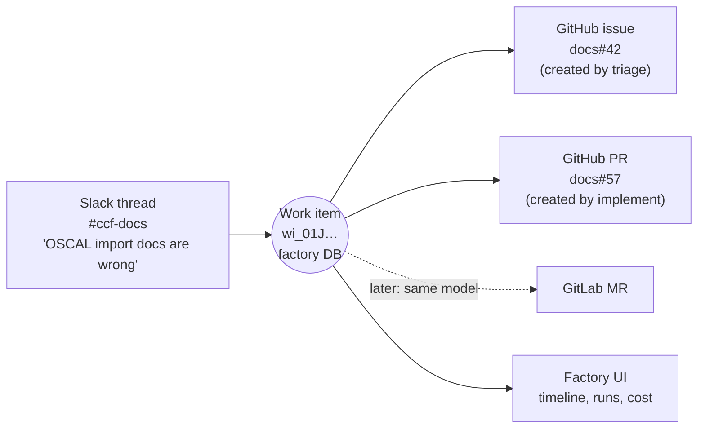

# 01 — Context and goals

> Status: **draft for discussion** · Last updated: 2026-10-15

## Problem

CCF maintains many repos in the `compliance-framework` GitHub org: `api`, `ui`, `agent`, about 50 `plugin-*` and `*-policies` repos, `helm-charts`, `workflows` and `docs`. Release automation (release-please, the release train, `release-finished` dispatches) already exists. But the work *around* a release, and around incoming issues and PRs, is still started by hand. Someone has to open a Claude Code session, load `ccf-skills`, and drive it.

The skills already work, and they work unattended. In the Oct 2026 lisa run, one overseeing session produced about 60 PRs across 11 repos in a day (`ccf-skills/lisa/docs/feedback-2026-10-07.md`). What's missing is the **plumbing**:

- something that notices that work exists,
- decides who should do it and how,
- runs it safely, and
- lets the next step happen without a human starting it.

## Goal

Build the **CCF Factory**: an event-driven system that

1. **receives notifications** from *Providers*: a Slack channel message, a new GitHub issue, a GitHub issue or PR comment, a PR opened or updated, a release finished, or a schedule. GitHub and Slack come first. The provider layer must also let us add others later (for example GitLab) without touching the dispatcher;
2. **routes** each one through a **central dispatch layer**, which owns every definition:
   - **providers**: how to connect (public GitHub, GitHub Enterprise, a Slack workspace);
   - **rules**: *when* to dispatch *what*;
   - **task specs**: *how* each role works (instructions, skills, tools, limits);
   - **queues and pools**: *who* runs the work and whether agents auto-scale;
3. **hands the task** to an **agent**: a thin overlay over an LLM harness (Claude Code or Codex at first) loaded with `ccf-skills`. The agent is either an already **registered** agent or one the dispatcher **creates just for this task**;
4. lets agents perform these first **roles**. Each role is a task spec plus the rules that dispatch it, and none is built into the engine:
   - **triage** an issue,
   - **implement docs changes for a new release**,
   - **implement** a triaged issue, or a decomposed epic as a stack of PRs,
   - **review** an open PR (one written by the factory or by a human), and
   - **merge** a PR that has passed review. This role is optional, and it is what makes a repo a "dark factory" end to end;
5. **shows its work** in a **Factory UI**, where people can watch the factory working and step in:
   - live and past work items, with their state and history across providers;
   - runs, including live progress, transcripts, cost and the reason each one was dispatched;
   - pending approvals and `needs-human` items;
   - per-repo configuration and the kill switches.

**Docs come first** (`compliance-framework/docs`, Docusaurus 3, GitHub Pages). The design must still generalise to the code repos without re-architecture.

## Non-goals (for now)

- Building our own LLM agent loop. We **wrap** existing harnesses; we don't replace them.
- A general-purpose agent platform for other teams. This is CCF-specific, but its layers are clean enough to swap parts later.
- Changing the product's own LLM features (`api/internal/service/llm`). Those are unrelated.

## Design principles

| # | Principle | Why |
|---|---|---|
| P1 | **Central definitions, thin agents.** Providers, rules, task specs (prompts, skills pins, limits), queues and pools live in the dispatcher's configuration. Agents receive a fully resolved task and nothing else. | One place to change behaviour. Agents are interchangeable and disposable. |
| P2 | **Harness-agnostic at one seam, with config both ways.** One small adapter contract. *Down* to the adapter: the task plus a **harness config** (model, reasoning effort, and harness-specific knobs). *Up* from the adapter: the result plus the **effective config and usage**. Each adapter also **advertises what it supports** (models, effort levels, features), so the dispatcher can validate a task spec's or rule's config before dispatching. Claude Code and Codex adapters on day one. | We need both harnesses, and must be able to tune model and effort per role (or per repo, or per run). The result records exactly what ran, which makes A/B comparisons and cost reports trustworthy. |
| P3 | **The factory owns its state; providers are adapters.** Work items, their state, runs and history live in the **factory's own state store**, in a provider-neutral model. The store is durable (a state dir, or object storage shared by several dispatchers: [P3](proposals/P3-dispatcher-state-in-object-storage.md)) and is the authority: nothing is rebuilt from the providers at start, and periodic resyncs still reconcile with them (P4). GitHub and Slack (and later GitLab) are *provider types*. Each concrete instance is a **Provider object** that says how to connect to it, for example public GitHub, GitHub Enterprise or a Slack workspace. Providers send events in and receive effects out. What the factory writes on a provider (labels, marker comments, Slack messages) is a **projection** of its state for humans. What humans do there (relabel, comment, approve, merge by hand) comes back as events that the factory interprets. | We aren't locked into GitHub. One work item can span providers. There's one place to query for the UI and for budgets. Provider-specific details (event shapes, effector operations, provider-specific skills) stay inside each provider adapter. |
| P4 | **Level-triggered reconciliation.** On every event, and on a periodic resync, compare the factory's state with what the providers currently show, then recompute "what is the next action for this work item?" rather than reacting to the event alone. | Idempotent, retry-safe and loop-resistant. Lost webhooks heal, and the factory notices when humans act out of band (say, a PR merged by hand). It's the same model as a Kubernetes controller. |
| P5 | **Least privilege per role.** Each run gets a short-lived, single-repo credential scoped to that role's permissions. Merge rights belong only to the `merge` task spec, under a separate identity. | Inputs can carry prompt injection, so the blast radius must be bounded by credentials, not by prompts. |
| P6 | **Central, opt-in repo configuration.** You onboard a repo (for example, "turn the factory on for `docs`") in the **dispatcher's configuration**, which is versioned in **git in this repo** and changed through PRs, not in the target repo. Onboarding means adding rules scoped to that repo on a given provider (`providerRef` / `providerSelector`), usually by adopting a rule set. Target repos need no factory files; the org-level app and webhook cover them. If no rule dispatches `merge`, humans merge. | One place to see and change what the factory does where. Repos stay clean, and repos that skip the factory keep working unchanged. |
| P7 | **The dispatcher's output is a manifest.** It produces a declarative `Task`, and a pluggable runtime backend turns that into a running agent (an Actions job, a k8s Job or Sandbox, an agent-orca `AgentRun`, a Managed Agents session…). | Keeps the runtime decision (still open) reversible. |
| P8 | **Every input is considered; none is trusted by default.** Issues from non-members and Slack messages are valuable. The **default rule set** we ship routes them through **triage**, which applies guardrails: • **who**: actor tier (maintainer / known contributor / anyone / bot) • **intent**: genuine, spam, abusive, or a prompt-injection attempt • **usefulness**: actionable, duplicate, needs info, or out of scope In the default rules, an item moves on to code-changing roles only after triage, and only through a gate that depends on the actor tier. This is policy written as rules (P10), not an engine behaviour. Actor tier and triage verdicts are plain facts that any rule can test. | CCF is a public project, so outside reports and contributions matter. Triage turns untrusted input into a vetted work item, so later roles never act on raw input from an unknown author. |
| P9 | **A visible factory.** Everything the factory does, and *why*, is visible in the Factory UI, and every provider-side artefact links back to it. That covers decisions, runs, live progress, transcripts, cost and approvals. | People trust what they can watch. It also makes debugging and approvals fast. |
| P10 | **Mechanism in the engine, policy in the catalog.** The engine only knows *how*: connect to providers, match events against rules, keep work-item state, enqueue tasks, schedule them onto pools, run agents and apply effects. *What happens when* is always written as **rules**: which events trigger which task specs, triage-first, gates, iteration limits and autonomy. The only engine invariants are a few **safety rails**: kill switches, budget ceilings, a per-item run cap (loop guard), dedupe, credential scoping and enforcement of each task's effects allow-list. | Changing behaviour should never need a code change. The safety rails stay because no rule mistake should be able to remove them. |

### Work items span providers

P3 is also where Slack fits. A work item is the factory's own record. It links **one or more provider objects**, possibly from different Provider instances, and keeps one state across all of them. For example:

- **Slack** is a provider like GitHub, in two ways:
  - **Ingress:** a message or mention can start a work item, or add input to one (for example, answering a triage question).
  - **Egress:** the factory replies in the thread, posts approvals and digests, and keeps the thread updated as the linked issue and PR progress.
- **GitLab later** means adding one provider adapter: its events in, its effector operations out, and its provider-specific skill variants. The dispatcher, rules and task specs stay the same. GitLab is **not planned**. We just keep the provider seam clean so it isn't ruled out, and we build nothing GitLab-specific.

## Decisions so far

| Topic | Decision | Consequence |
|---|---|---|
| Runtime | Undecided. Keep it pluggable (P7). | Compared in [06](06-technology-options.md). |
| Harness | Agnostic. Claude Code and Codex at start (P2). | The adapter contract carries harness config both ways. |
| Autonomy | Gated by role, expressed as rules. Dispatching the `merge` task spec is optional; a repo is "dark factory" when its rules dispatch it (P6). | Repos opt out by not having a merge rule. |
| Policy model | **Rule → TaskSpec → Queue → Pool**, with Provider objects holding connection details. Rules are reusable and scope-less. **RuleSets** (mandatory) bind provider instances and a scope and select rules. There are no flows in the engine (P10). | Behaviour changes are catalog PRs. The engine stays generic. |
| Central config | **Git, in this repo.** Providers (connection details, secrets by reference only), rules, task specs, queues and pools are files reviewed through PRs. The UI displays the config but doesn't edit it. | One review path for every behaviour change. A UI editor can come later and would write PRs. |
| Factory state | **A durable store** behind a store interface: a state dir for one dispatcher (P2), object storage shared by several (P3). It started in memory, rebuilt at start from the providers' projections; with durable state that rebuild is gone ([P3 §No rebuild from markers](proposals/P3-dispatcher-state-in-object-storage.md#no-rebuild-from-markers)). | Provider-side projections (labels, hidden marker comments) are for people to read. Lost state is lost: open items start fresh on their next event, and redeliveries, reopened issues or re-applied labels recover what matters (P3 Decision 7). Several dispatchers share one store, one of them leading the controllers. |
| Providers | **PoC: GitHub only.** Slack later (with flexible sender, content and command rules). GitLab is not planned, but not ruled out (P3). | Provider-neutral work-item model and a provider adapter interface. Nothing GitLab-specific gets built. |
| PoC scope | Two use cases on `docs`: **release train → per-repo versioned docs → review → merge**, and **i18n epic → PR stack → PT-BR live**, plus factory review of every human PR. Roadmap covers the PoC only. | [10](10-poc.md), [08](08-roadmap.md) |
| Licence | **AGPL-3.0.** The factory is open source; catalog and prompts are public. | Secrets only by reference |
| Tickets | **GitHub Issues** for the PoC; Jira only if the factory proves its value | Skills map issues to `./tickets/` in headless mode |

## Assets we already have

| Asset | Where | How the factory uses it |
|---|---|---|
| `ccf-skills` Claude Code plugin marketplace (`ccf-review`; `lisa` on a branch) plus loose skills (`bugreport`, `bugfix`, `resolve`, `plugin`, `policy-review`, …) | `compliance-framework/ccf-skills` | The skills each role loads. Some need a **headless mode** (see [05](05-agent-runtime.md#making-ccf-skills-headless-friendly)). |
| The `lisa` CLI (`lib/lisa`): GitHub, git and notes operations, GitHub App auth, stacks | `ccf-skills/lisa/lib` | Prototype of the factory's **effector** (the only way agents change GitHub). |
| `ccf-review` rule catalog and `ccfr` CLI | `ccf-skills/ccf-review` | Backbone of the **review** role. |
| `release-finished` `repository_dispatch` (`{repo, tag, conclusion}`) | `workflows/.github/workflows/release-finished.yml` | The trigger for the **release-docs** role. |
| `repos.yaml` manifest (kinds, `depends_on`) | `workflows/repos.yaml` | Seed for the repo scopes that rules use (by kind, e.g. all `plugin-*`). |
| Slack posting toolkit (`internal/slackkit`, `chat:write`) | `workflows` | Reuse for notifications. Intake needs new scopes. |
| GitHub Apps `ccf-release-bot`, `ccf-repo-admin`, `ccf-lisa` | org | `ccf-lisa` is close to what the factory needs. **`ccf-release-bot` must never be given to agents**, because it bypasses the review ruleset. |
| Org conventions: reusable workflows, `needs-human` label, `#ccf-*` channels | `workflows` | The factory follows them, not new ones. |

## Glossary

See [03 — Domain model](03-domain-model.md) for the full definitions.

- **Catalog** — all of the factory's configuration, kept as YAML files under `catalog/` in this repo: Providers, Groups, Rules, RuleSets, TaskSpecs, Templates, Queues and Pools. It's the dispatcher's desired state, changed only by PR. The dispatcher's **catalog-sync** controller loads it from git, validates it, and applies it.
- **Provider** — a Provider object: one concrete instance of a provider type (GitHub, Slack, later GitLab), with how to connect to it (endpoint, app identities, secret references, scope) and labels such as `network: public` or `network: enterprise`.
- **Event** — a normalised notification (a CloudEvents envelope) from a provider, a schedule or the factory itself (e.g. `run.completed`).
- **Rule** — *when*: on an event type from selected providers, where a condition holds, dispatch a task spec (with a harness config) to a queue, and/or set work-item state, notify, or cancel.
- **RuleSet** — the mandatory binding of rules to provider instances and a scope. It selects rules (refs or label selector), overrides their params, and sets defaults and budgets. What the first draft called a "flow" is just a RuleSet's rules reacting to each other's events.
- **Task spec** — *what and how* for one role (triage, review, …): instructions, skills, permissions, effects, limits and output schema. A template for tasks.
- **Queue** — where dispatched tasks wait. It has a concurrency limit and priority, and is drained by a pool.
- **Pool** — *who* executes tasks: `ephemeral` (the factory creates an agent per task, with a scaling policy) or `registered` (long-lived agents join and pull work).
- **Work item** — the factory's own long-lived record of a piece of work, stored in the factory DB. It links one or more provider objects (a Slack thread, an issue, a PR, a release) and holds state keys set by rules.
- **Task** — one instance of a task spec for a work item: the immutable manifest an agent executes.
- **Run** — one execution attempt of a task by an agent.
- **Agent** — a worker in a pool: a harness adapter plus a runtime.
- **Harness** — the LLM coding agent being wrapped: Claude Code or Codex.
- **Harness config** — model, reasoning effort and harness-specific knobs. It goes down to the adapter with the task and comes back up as the effective config and usage.
- **Effector** — the factory-controlled tool the agent uses to make changes on providers, such as comments, labels, PRs, merges and Slack replies. Provider adapters implement its operations.
- **Controller** — a dispatcher component that watches resources in the factory DB and reconciles them, in the style of a Kubernetes controller.
