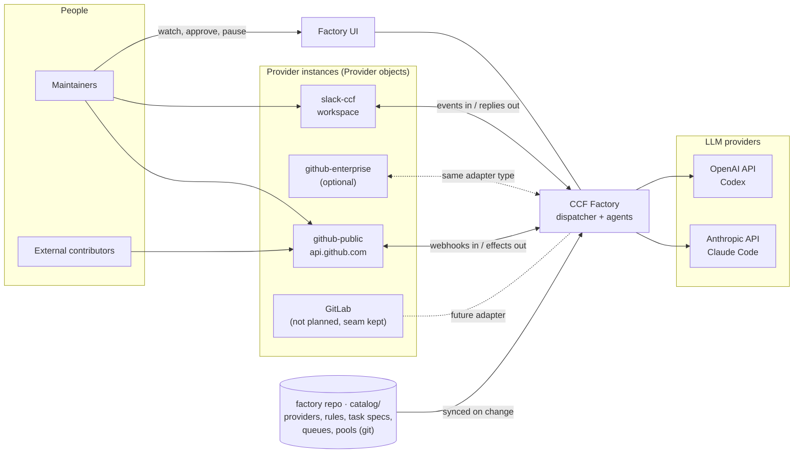
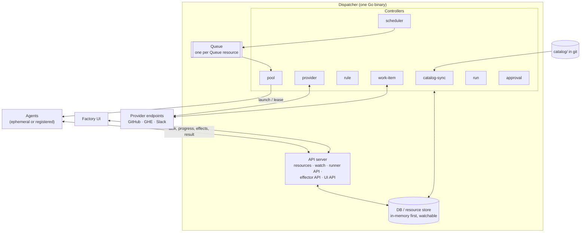
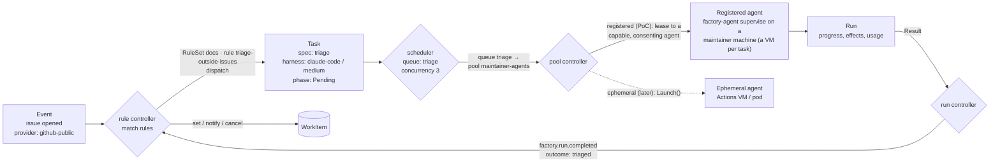
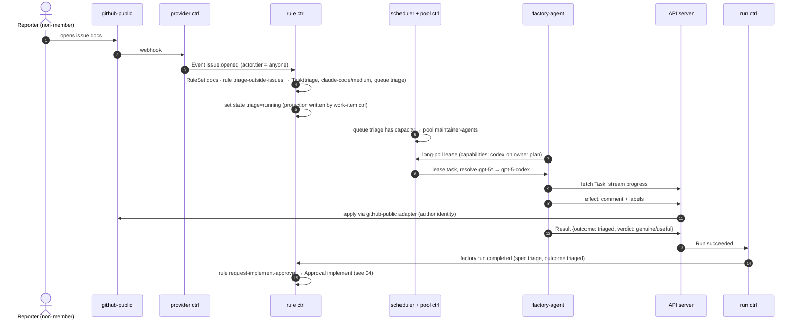
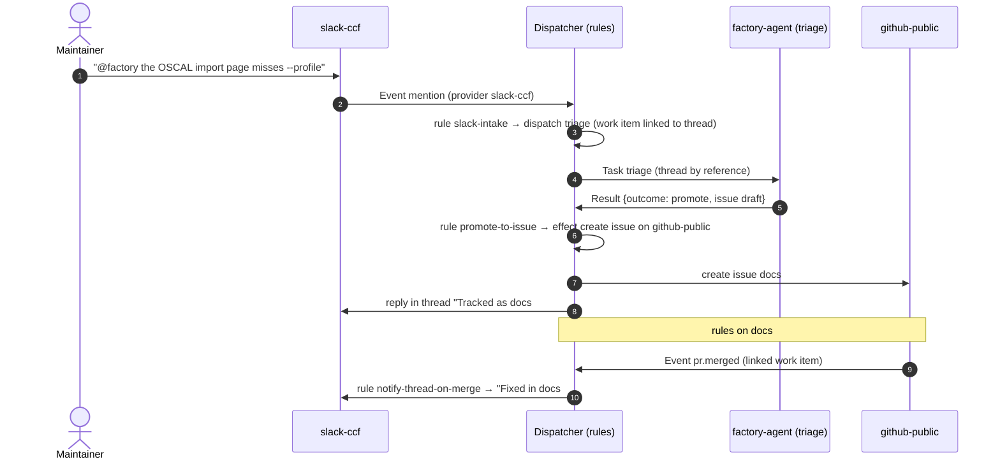
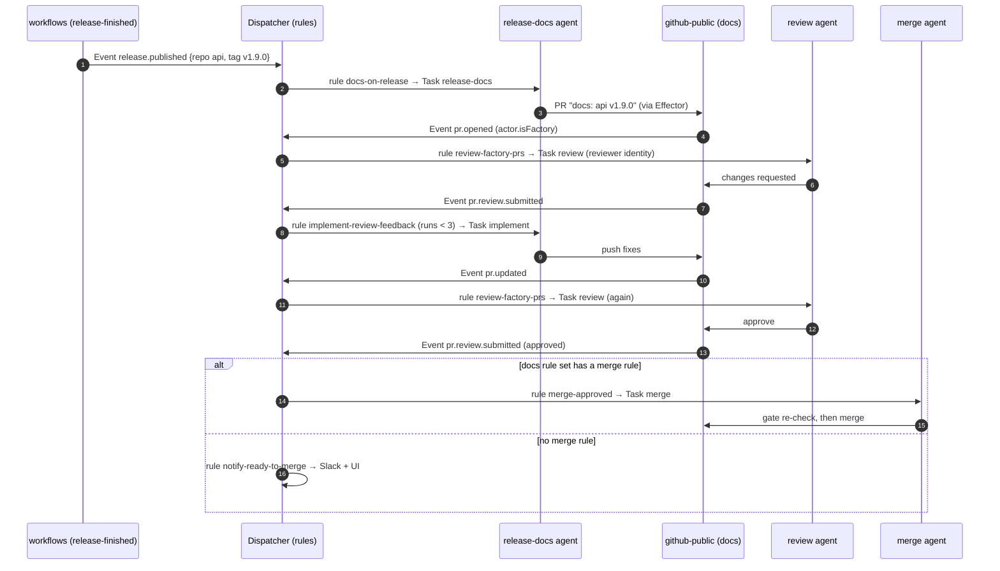

# 02 — Architecture

> Status: **draft for discussion** · Last updated: 2026-10-15 · Implements the principles in [01](01-context-and-goals.md#design-principles) (P1–P10). Resource definitions are in [03](03-domain-model.md); example rule sets are in [04](04-flows.md).

## System context



## The dispatcher: controllers, an API, a DB, a queue and a UI

The dispatcher is built like a small Kubernetes control plane:

- **Everything is a resource in the DB.** Configuration resources are synced from git. Runtime resources are created as work happens.
- **Controllers** each watch some kinds and reconcile them toward the desired state.
- The **API** is the only way in and out, for runners, the Effector and the UI.
- The **queue** holds dispatched tasks until a pool picks them up.



### Resources

| Kind | Source | Owned / reconciled by | Purpose |
|---|---|---|---|
| `Provider` | git | provider controller | How to connect to one provider instance (public GitHub, GHE, a Slack workspace). Status shows connection health. |
| `Rule` | git | rule controller (reads) | *When*: reusable `on` + `where` → actions; `providerSelector` for type compatibility; no scope |
| `RuleSet` | git | rule controller (reads) | *Where*: binds provider instances, sets scope, selects rules (refs or selector), overrides params. **Mandatory**: rules only fire through a RuleSet. |
| `Group`, `Template` | git | provider adapters resolve members; notifier renders | *Who* (maintainers, approvers, trust tiers) and *what to say* (bodies per provider type) |
| `TaskSpec` | git | rule controller (reads) | *What and how* for a role |
| `Queue` | git | scheduler | Concurrency, priority, budget; which pool drains it |
| `Pool` | git | pool controller | Registered agents (PoC) or ephemeral agents with scaling (later) |
| `Event` | DB, short-lived | rule controller | Normalised event (CloudEvents) from a Provider instance or the built-in `factory` provider |
| `Delivery` | DB, short-lived | provider controller | Raw provider webhook, stored **before** it's acknowledged; normalised into one or more Events |
| `Approval` | DB | approval controller | A pending human gate. It resolves into `factory.approval.*` events. **Future (Q18): not built in the PoC.** |
| `WorkItem` | DB | work-item controller | Links provider objects; state keys; projection |
| `Task` | DB | scheduler → pool controller | One instance of a task spec for a work item (immutable spec, mutable status) |
| `Run` | DB | run controller | One execution attempt: agent, progress, usage, result |
| `Agent` | DB | pool controller | A registered agent (`factory-agent supervise`): owner, capabilities (harnesses, auth mode, models, efforts), consent, heartbeat, throttling. Or an ephemeral agent's handle. |
| `Effect` | DB | API (applied synchronously) | Audit record of every change made on a provider |
| `BudgetCounter` | DB | scheduler | Daily usage per queue, RuleSet and global scope (runs, tokens, USD) |

The model is deliberately **Kubernetes-shaped**: `metadata`, `spec`, `status`, labels and selectors, controllers. That keeps the option of later running the config kinds as real CRDs on a cluster. It's not a requirement, because the same controllers run against our own store.

### Controllers

| Controller | Watches | Does |
|---|---|---|
| **catalog-sync** | git (`main` of this repo) | Loads `catalog/` at a SHA. Validates schemas, CEL expressions, references and harness configs (against adapter capability descriptors). Applies the config resources atomically. A bad catalog is rejected whole, and the previous SHA stays live. |
| **provider** | `Provider` | Runs one adapter instance per Provider object: opens the webhook route or Socket Mode connection, verifies and dedupes inbound calls, and normalises them into `Event` resources. Resolves the actor's tier with that provider's trust config. Reports health in `Provider.status`. |
| **rule** | `Event` (provider and `factory.*`), schedule ticks | Finds the work item for the event (or creates one). Finds the RuleSets in scope: for provider events by bound provider and scope; for `factory.*` events by the work item's linked objects. Evaluates their selected rules (`on` → `where`, `priority`/`final`), dedupes per (event, rule), checks the **safety rails**, and runs the actions. `dispatch` creates a `Task` (`Pending`) in its queue. `requestApproval` creates an `Approval`. `notify` renders a Template and sends it through the providers. |
| **work-item** | `WorkItem`, provider observations | Calls `Observe` on linked objects to merge in out-of-band human actions, and writes the **projection** (labels, marker comment, Slack metadata). It runs the periodic **resync** (re-observe against the stored baselines, then emit `workitem.resynced` events so rules can react). No rebuild on startup: the store is the authority (P3). |
| **scheduler** | `Task` (Pending), `Queue` | Orders tasks by priority, applies the queue's concurrency and budget, and offers it to the queue's pool; a matched task becomes `Leased`. This is the same idea as Kubernetes pod scheduling. Details: [scheduler-and-pools.md](workstreams/dispatcher-runtime/LLD/scheduler-and-pools.md). |
| **pool** | `Task` (Pending), `Pool`, `Agent` | **Registered pool (PoC):** matches tasks to connected agents by capability. That includes **resolving harness config patterns** against what the agent offers ([03](03-domain-model.md#patterns-in-harness-config)), respecting consent, hours and throttling. It then grants **leases**, and handles heartbeats and expired leases. **Ephemeral pool (later):** launches an agent through the pool's backend within `scaling.max`. |
| **run** | `Run` | Tracks progress, enforces wall-clock limits, cancels runs whose work item moved on (e.g. a review of a stale commit), and ingests the Result. Emits **`factory.run.completed`** / **`factory.run.failed`** from the built-in `factory` provider, which loops back into the rule controller. |
| **approval** *(future, Q18)* | `Approval`, candidate decisions from providers and UI | Presents approvals on their channels (templated GitHub comment, Slack buttons, UI), checks each decision's actor against the approver Group, applies the quorum and expiry, and emits **`factory.approval.granted` / `.denied` / `.expired`**. |

### API server

| Surface | Clients | Notes |
|---|---|---|
| **Runner API** | agents | Register (owner device-flow login + join token), lease (long-poll), fetch the leased task, heartbeat with progress, complete or abandon. Agents authenticate with an **agent bearer token**; task routes also require that the agent holds the task's lease. |
| **Effector API** | agents (through the Effector CLI or MCP) | Effect requests are checked against the task's effects allow-list, recorded as `Effect` resources, and applied through the Provider's adapter. **Provider credentials never leave the dispatcher.** |
| **Resource API** | UI, CLI (`factory get rules`, `factory describe workitem …`), tests | Read and watch. Config kinds are read-only here (they come from git, ADR-0006). |
| **Command API** | UI, CLI | Pause, resume, cancel, re-dispatch, dispatch, resync-catalog (approve/deny come with Approvals, Q18). Each command becomes a **`factory.command.*` event**, so it goes through the rules like everything else. |

### DB and queue

- **DB:** a resource store behind a `Store` interface with get, list, watch, a compare-and-swap update, and per-(work item, task spec) locks. It starts **in-memory**. Postgres replaces it later behind the same interface.
- **Durable state, no rebuild:** `factory serve` keeps the store durable: in files with `--state-dir` (one dispatcher; [store.md §Serving](workstreams/dispatcher-runtime/LLD/store.md#serving-factory-serve---state-dir), on in the PoC run kit) or in object storage with `--state-url` (shared by several dispatchers, one of which leads; [P3](proposals/P3-dispatcher-state-in-object-storage.md)). The store is the authority: nothing is rebuilt from the GitHub markers at start ([P3 §No rebuild from markers](proposals/P3-dispatcher-state-in-object-storage.md#no-rebuild-from-markers), which supersedes [ADR-0001](adr/0001-factory-owns-work-state.md)'s start-up rebuild). The factory still writes each work item's **projection**, for people to read:

  ```markdown
  <!-- factory:wi v=1 id=wi_01JA… state=release:drafting,train:compliance-framework%2Fworkflows%23123 runs=release-docs:1 links=github-public:compliance-framework%2Fdocs%2357 -->
  ```

  The format (versioned, URL-encoded values, `b64:` for structured values) is defined once in [github-provider.md §Observe, list and projection](workstreams/provider-github/LLD/github-provider.md#observe-list-and-projection). An event handled wrongly is replayed from the stored events. When the state itself is lost (a deleted bucket or dir, a reset), open items start fresh on their next event, with no rule state and no run counters (P3 Decision 7). `--state-memory` keeps the store in memory, for tests and quick local runs. Runs that finish while the dispatcher is down report back with their full task (the runner keeps a copy).
- **Queue:** one logical queue per `Queue` resource, implemented on the store at first. Tasks are `Task` resources with a phase (`Pending → Leased → Running → Succeeded / Failed / Cancelled`, plus `Cancelling`; a task waiting on budget or capacity stays `Pending` with a reason). That gives leases, retries and visibility in the UI for free. Postgres with SKIP LOCKED (e.g. River) comes when the store goes durable.

### Factory UI

The UI is a client of the Resource and Command APIs (P9):

| View | Shows |
|---|---|
| **Board** | Work items by state, per provider and scope; the `needs-human` queue on top |
| **Work item** | Timeline across providers. Every decision shows **which rule fired and why** (event, condition inputs, safety-rail verdict). |
| **Queues and pools** | Depth, running and leased tasks, ephemeral scale, registered agents and their capabilities |
| **Run** | Live progress (SSE), transcript, harness and effective config, cost, effects performed |
| **Catalog** | Loaded git SHA, providers and their health, rules (plus a "would this rule match?" dry-run against a recorded event), task specs, queues, pools. **Read-only.** |
| **Controls** | Pause or resume (global, provider, queue, work item), cancel, re-dispatch, resync catalog (approve/deny later, Q18) |

Sign-in is through OAuth against a configured Provider (GitHub org members). Commands require membership of the `maintainers` Group (the CCF org admins in the PoC, Q17).

## Provider objects and adapters

A **Provider object** is configuration: which adapter type, how to connect, which identities to use, how to resolve actor tiers, and the scope it covers. **Secrets are referenced, never inlined.** Rules select providers by name (`providerRef`) or by label (`providerSelector`), so one rule can cover public GitHub and GitHub Enterprise at once. See [03](03-domain-model.md#provider) for full examples.

Each adapter type implements one interface. The provider controller creates one instance per Provider object. The authoritative definition is [contracts.md §Provider interface](workstreams/foundation/LLD/contracts.md#provider-interface):

```go
type Adapter interface {
    Type() string                                                  // "github" | "slack" | …
    Connect(ctx context.Context, p Provider, secrets SecretResolver) (Conn, error)
}
type Conn interface {
    // Ingress: persist before acknowledging; re-ingest missed deliveries on startup
    Handler(sink IngressSink) http.Handler
    Recover(ctx context.Context, since time.Time, sink IngressSink) error
    Normalise(ctx context.Context, ev RawEvent) ([]Event, error)  // one delivery → 0..n events, actor tier resolved
    // Observation
    Observe(ctx context.Context, ref ObjectRef) (Observation, error)
    List(ctx context.Context, scope Scope) ([]ObjectRef, error)    // no caller since P3: removed with the rebuild (P3 PR 6)
    ResolveGroup(ctx context.Context, g GroupSource) ([]string, error)
    // Projection + effects
    Project(ctx context.Context, ref ObjectRef, p Projection) error
    Apply(ctx context.Context, e EffectRequest) (EffectResult, error)
    // Credentials for agents
    MintGitCredential(ctx context.Context, req GitCredentialRequest) (Credential, error)
    Health() HealthStatus
}
```

Normalised events share **provider-neutral vocabularies**, so rules read the same on any provider. Each provider **type** declares which ones it emits (see [03](03-domain-model.md#event-vocabularies)):

- `issue.*` and `pr.*`: GitHub (and GitLab, one day);
- `release.*`: GitHub;
- `message.*`: Slack;
- `factory.*`: **only** the built-in, reserved `factory` provider (`factory.run.completed`, `factory.approval.granted`, `factory.schedule.tick`, `factory.workitem.resynced`, `factory.command.*`). The catalog rejects adapters that declare `factory.*` types, and the normaliser drops them at runtime. So a provider can never spoof a run result.

Provider-specific details stay reachable as `event.raw` for the rare rule that needs them.

## How an event becomes a run



There's no built-in chaining. "After triage, maybe implement" is simply a rule on `factory.run.completed` with `where: run.spec == 'triage' && run.outcome == 'triaged' && …`. The engine itself never knows that triage comes before fix (P10).

### Safety rails (the only engine invariants)

The rule controller checks these before every action, and the scheduler checks them again before binding:

| Rail | Behaviour |
|---|---|
| Kill switches | Global, per Provider, per Queue, and per work item (`factory:stop` label or command). Matching actions are recorded as *suppressed*. |
| Budget ceilings | Global daily, plus per Queue / RuleSet. Over budget, a task stays `Pending` with the reason `budget`, and a notification goes out. It's never dropped silently. |
| Per-item run cap | A hard maximum of runs per work item (default 20), which no rule can override. It catches rule loops. |
| Single active run | At most one active task per (work item, task spec), unless the rule opts out explicitly. |
| Dedupe | Per (event id, rule). Replays don't re-dispatch. |
| Echo marking | Events caused by the factory's own effects carry `actor.isFactory`, so rules can tell them apart. The engine doesn't drop them, because some rules want them (e.g. review the PR the factory just opened). |
| Effects allow-list | Enforced by the Effector API for every effect, whatever the agent does |
| Credential scoping | Git credentials are minted per task: **write on at most one repo** (the task's `rw` workspace repo), read on the other declared repos, with the task spec's permissions and a TTL of ≤1h |

## Harness config, both ways

The harness config travels with the task (P2). Its value resolves in this order: **TaskSpec default → RuleSet default → Rule `dispatch.harness` → command override** (e.g. a manual re-dispatch with a different model).

```yaml
# down, in the Task
harness:
  name: codex
  config: { model: gpt-5-codex, reasoningEffort: high, extra: { } }   # model id is a placeholder
```

```yaml
# up, in the Result
harness:
  name: codex
  version: "0.x.y"
  effectiveConfig: { model: gpt-5-codex-2026-09-01, reasoningEffort: high }
  usage: { inputTokens: 182340, outputTokens: 9120, costUSD: 0.73, turns: 22, wallClock: 4m51s }
```

Each adapter publishes a **capability descriptor**: models, effort levels and their native mapping, and features. catalog-sync validates every rule and task spec against it, so `reasoningEffort: extreme` fails the catalog PR, not a run.

## Agent (`factory-agent`)

Detailed in [05](05-agent-runtime.md). The runner:

- fetches the task;
- prepares the workspace with a scoped git credential;
- materialises the pinned skills for the harness;
- renders the prompt, with untrusted content fenced;
- runs the harness adapter with the harness config;
- streams progress;
- performs effects only through the Effector API;
- returns a validated Result.

## Key sequences

### A new issue from a non-member gets triaged



### A Slack message becomes an issue, and the thread follows it



### A release finishes → docs PR → review → merge

Each arrow out of the dispatcher is a different **rule**. Their full definitions are in [04](04-flows.md#release-docs).



## Deployment shapes

All dispatcher components (API, DB, queue, controllers and the UI's static assets) ship in **one binary**. The runtime behind each Pool stays pluggable. The comparison is in [06](06-technology-options.md) and the plan in [08](08-roadmap.md).

| Shape | Dispatcher | DB / queue | Pools | When |
|---|---|---|---|---|
| **A. PoC** | Single replica; GitHub App webhook only (Slack is future, Q1); plain Go binary, not Kubernetes ([10](10-poc.md#build-on-kubernetes-for-the-poc)) | In-memory at first, rebuilt from projections; then a state dir (P2) and object storage (P3), with no rebuild | **Registered only**: `maintainer-agents`, Codex on owners' plans (default), Claude Code on API keys (validation) ([10](10-poc.md#registered-agents-codex-on-subscriptions-claude-on-api-keys)) | `docs`, first weeks |
| **B. Durable** *(future, not planned)* | Same | Postgres behind `Store` (queue on SKIP LOCKED); history survives; HA possible | + ephemeral pools (`actions-ephemeral`, API-key auth) for capacity that doesn't depend on someone's machine | More repos, budgets and reporting |
| **C. Scale** *(future, not planned)* | HA | Postgres, or config kinds as CRDs on a cluster | k8s / Agent Sandbox ephemeral pools with warm pools; optional kagent / agent-orca backends | Volume or cost demands it |

For local development, the same binary runs on a laptop: Slack via Socket Mode, GitHub webhooks via smee or `gh webhook forward`, and the developer's own `factory-agent supervise` registers as the only agent.
