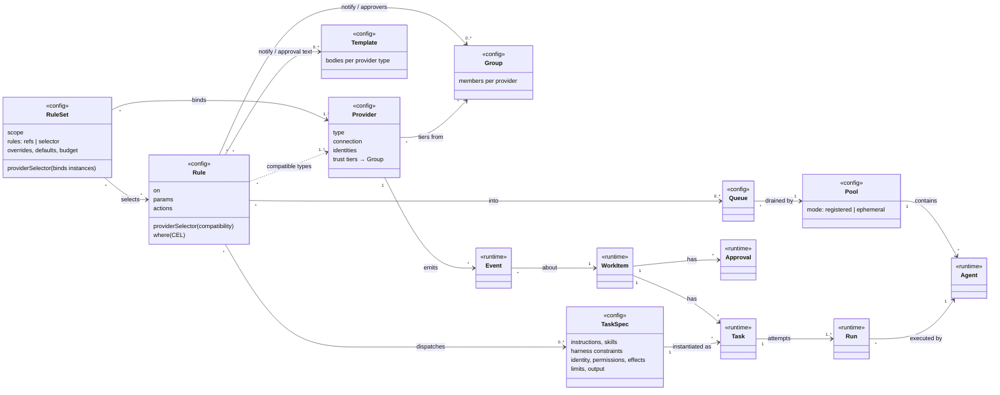

# 03 — Domain model and catalog

> Status: **draft for discussion** · Last updated: 2026-10-15

Every concept is a **resource** with the Kubernetes shape `apiVersion` / `kind` / `metadata` (name, labels) / `spec` / `status`.

- **Config kinds** live in git under `catalog/` and are synced by the catalog-sync controller (ADR-0006).
- **Runtime kinds** live in the dispatcher's DB.

The YAML here is illustrative. The authoritative shapes are the JSON Schemas in `schemas/` at the repo root, generated from the Go types with `make schemas`.



## Catalog layout (proposed)

```text
catalog/
├── providers/        # how to connect: github-public, github-enterprise, slack-ccf
├── groups/           # who: maintainers, docs-owners, …
├── rules/            # WHEN: reusable, scope-less, labelled into packs
├── rulesets/         # WHERE: bind providers + scope, select rules, override params
├── taskspecs/        # WHAT + HOW: triage, release-docs, implement, review, merge
├── prompts/          # prompt templates referenced by task specs
├── templates/        # notification and approval message templates
├── queues/
├── pools/
├── harnesses/        # harness defaults per adapter (models, effort)
├── schemas/          # TaskSpec result schemas (schemas/results/*); the kind schemas are generated at the repo root (schemas/)
└── testdata/         # recorded events for `factory rules test`
```

## Provider

A Provider describes **how to connect** to one provider instance. It never contains rules, and never contains secrets inline.

```yaml
apiVersion: factory.ccf.dev/v1alpha1
kind: Provider
metadata:
  name: github-public
  labels: { family: github, network: public }
spec:
  type: github
  github:
    apiURL: https://api.github.com
    webhook: { path: /hooks/github-public, secretRef: { name: github-public-webhook, key: secret } }
    identities:                               # GitHub Apps this provider can act as
      author:   { appID: 123456, privateKeyRef: { name: ccf-factory-app, key: private-key } }
      reviewer: { appID: 234567, privateKeyRef: { name: ccf-factory-reviewer-app, key: private-key } }
  scope: { orgs: [compliance-framework] }     # outer bound; RuleSets can only narrow it
  trust:                                      # how actor.tier is resolved, first match wins
    - { tier: maintainer, group: maintainers }
    - { tier: contributor, authorAssociation: [CONTRIBUTOR, COLLABORATOR] }
    - { tier: bot, bots: ["dependabot[bot]", "release-please[bot]"] }
    - { tier: anyone }
  resync: { every: 10m }
---
kind: Provider
metadata: { name: github-enterprise, labels: { family: github, network: enterprise } }
spec:
  type: github
  github:
    apiURL: https://ghe.example.internal/api/v3   # same adapter type, different endpoint and apps
    webhook: { path: /hooks/github-enterprise, secretRef: { name: ghe-webhook, key: secret } }
    identities: { author: { appID: 42, privateKeyRef: { name: ghe-factory-app, key: private-key } } }
  scope: { orgs: [ccf-internal] }
  trust: [{ tier: maintainer, group: maintainers }, { tier: anyone }]
---
kind: Provider
metadata: { name: slack-ccf, labels: { family: slack } }
spec:
  type: slack
  slack:
    mode: socket
    appTokenRef: { name: slack-ccf, key: app-token }
    botTokenRef: { name: slack-ccf, key: bot-token }
  scope: { channels: ["#ccf-docs", "#ccf-factory"] }
  trust: [{ tier: maintainer, group: maintainers }, { tier: anyone, workspaceMember: true }]
```

### The built-in `factory` provider

The factory itself is a provider: a **reserved, built-in instance named `factory`** of type `factory`. It isn't declared in the catalog and can't be redefined. It's the **only** source allowed to emit `factory.*` events:

| Event | Emitted when |
|---|---|
| `factory.run.completed` / `factory.run.failed` | The run controller ingests a Result, or a run times out or is cancelled |
| `factory.approval.granted` / `.denied` / `.expired` | An Approval resolves (see [Approval](#approval)) |
| `factory.schedule.tick` | A rule with a `schedule` (cron) fires |
| `factory.workitem.resynced` | The work-item controller re-observed an item |
| `factory.command.*` | UI, CLI or chat commands: pause, resume, re-dispatch… |

This resolves the naming problem. `run.completed` isn't a free-floating type that any provider could also send: it's `factory.run.completed`, from `source: factory`. The catalog validates that **no adapter declares `factory.*` types**, and the normaliser rejects them at runtime.

### Event vocabularies

Each provider **type** declares the event types it can emit (the authoritative list is [contracts.md §Event vocabulary](workstreams/foundation/LLD/contracts.md#event-vocabulary)). The neutral domains are shared on purpose, so rules port across GitHub, GHE and (one day) GitLab:

| Domain | Types | Emitted by provider types |
|---|---|---|
| `issue.*` | `issue.opened`, `issue.commented`, `issue.labeled`, `issue.closed` | github (gitlab later) |
| `pr.*` | `pr.opened`, `pr.updated`, `pr.ready_for_review`, `pr.labeled`, `pr.review.submitted`, `pr.checks.completed`, `pr.merged`, `pr.closed` | github (gitlab later) |
| `release.*` | `release.published`, with facts `event.release.semver` (`major`, `minor`, `patch`, `prerelease`, `bump`) and `previousTag` | github (including the `release-finished` dispatch) |
| `deploy.*` | `deploy.succeeded`, `deploy.failed` (GitHub `deployment_status`; linked to work items by commit) | github |
| `message.*` | `message.posted`, `message.mention` | slack (future) |
| `factory.*` | as above | `factory` only |

The full CloudEvents identity of an event is `(source = provider instance, type)`. Rules match `type`. The provider comes from the RuleSet binding, or is `factory` for `factory.*` types.

## Group

A Group is **who**: a named set of people resolved per provider. Trust tiers, notifications and approvals all refer to Groups, so "maintainers" is defined once.

```yaml
kind: Group
metadata: { name: maintainers }
spec:
  members:
    - { provider: github-public, orgRole: { org: compliance-framework, role: admin } }   # PoC: the CCF org admins (Q17)
    # other sources: { provider, team: org/slug } · { provider, users: [...] } · { provider: slack-ccf, userGroup: "@…" }
    - { provider: github-enterprise, team: ccf-internal/maintainers }
    - { provider: slack-ccf, userGroup: "@ccf-maintainers" }
  cache: { ttl: 10m }       # resolved by the provider adapters, cached by the dispatcher
```

## Template

A Template is the **text** for notifications and approval prompts. Each provider type gets its own body, because Slack Block Kit and GitHub Markdown differ. Bodies use Go `text/template` over the same variables rules see (`event`, `actor`, `item`, `run`, `approval`), plus `links.ui` (the work item in the Factory UI).

```yaml
kind: Template
metadata: { name: approve-implement }
spec:
  bodies:
    github: |
      **Triage done** · {{ .run.result.summary }}
      A maintainer can approve implementation with `/factory approve implement` or the `factory:approve-implement` label.
      [View in Factory UI]({{ .links.ui }})
    slack:
      blocks: templates/approve-implement.slack.json   # Block Kit, with Approve / Deny buttons
```

## Rule

A rule is **when** and **what**, and it's **reusable**. It has **no scope**: where it applies is decided by the RuleSets that select it.

| Field | Meaning |
|---|---|
| `metadata.labels` | Used by `RuleSet.rules.selector` to pick rules (e.g. `pack: intake`) |
| `providerSelector` | Which provider **types or families** the rule is written for (e.g. `family: github`). Used for **validation**: each type in `on` must be one the selected providers can emit. It does not bind instances; RuleSets do that. Not needed when `on` contains only `factory.*` types. |
| `on` | Event types |
| `where` | CEL over `event`, `actor`, `item`, `run`, `approval`, `provider`, `params`, `now` |
| `params` | Declared parameters with defaults (e.g. `harness`, `queue`, `maxImplementRuns`). A RuleSet can override them per rule. |
| `actions` | Ordered list from: `dispatch`, `set`, `notify`, `requestApproval`, `cancel`, `link`, `effect`. String values starting with `=` are CEL evaluated at runtime; `{{ params.x }}` is substituted at catalog load. |
| `priority`, `final` | Order among matching rules; `final` stops lower-priority matches for this event and work item |
| `debounce` | `{ window, key }`: collapse bursts into one action |
| `schedule` | Cron. Only with `on: [factory.schedule.tick]`. |

```yaml
kind: Rule
metadata:
  name: triage-outside-issues
  labels: { pack: intake }
spec:
  providerSelector: { matchLabels: { family: github } }
  on: [issue.opened]
  where: "actor.tier in ['anyone', 'contributor'] && !actor.isBot"
  params:
    queue: triage
    harness: { name: codex, config: { model: "gpt-5*", reasoningEffort: medium } }
  actions:
    - dispatch: { taskSpec: triage, queue: "{{ params.queue }}", harness: "{{ params.harness }}", context: [event.object] }
    - set: { triage: running }
```

### Actions

| Action | Shape | Effect |
|---|---|---|
| `dispatch` | `{ taskSpec, queue, inputs?, harness?, requires?, context?, target? }` | Creates a `Task` (`Pending`) in the queue. `inputs` must match the TaskSpec's declared `inputs`. `target` overrides which repo or object the work happens on (e.g. a release in `api` → work in `docs`). |
| `set` | `{ key: literal \| "=CEL" }` | Updates work-item state keys. Values may be structured (lists or maps). Later actions in the same rule see the update. |
| `notify` | `{ template, to: [destination…] }` | Sends a message through the providers; no LLM involved. Destinations: `{ group: maintainers, via: slack-ccf, as: mention \| dm }`, `{ channel: { provider: slack-ccf, name: "#ccf-docs" } }`, `{ item: primary \| threads \| all }` (comment on, or reply in, the work item's linked objects). |
| `requestApproval` | `{ name, approvers: Group, quorum?, via: [ui, slack, github], template, expires? }` | Creates an `Approval`. The result arrives later as `factory.approval.*`. |
| `cancel` | `{ taskSpec }` | Cancels active tasks for this item and task spec |
| `link` | `{ from }` | Adds a provider object (e.g. a just-created issue) to the work item |
| `effect` | `{ op, … }` | A direct, no-LLM provider effect: `label.add`, `create-issue`, `sub-issue.add`, `close`, … |

### Evaluation semantics

1. When an event arrives, find or create its **work item**. Provider events map through object refs and links. `factory.*` events always carry their work item id.
2. Find the **RuleSets in scope**:
   - For provider events: the RuleSet binds that provider instance, and its `scope` matches the event's object.
   - For `factory.*` events: the RuleSet's `scope` matches **any object linked to the work item**. That's how `factory.run.completed` for a triage on `docs#42` reaches the `docs` RuleSet.
3. Within each RuleSet, take its selected rules, filter by `on`, then evaluate `where` in `priority` order, respecting `final`. A rule sees state written by higher-priority rules for the same event.
4. **Deduplicate firing per (event, rule).** If two RuleSets select the same rule for the same object, each evaluates its `where` with its own params, and the rule fires at most once, through the first RuleSet (by name) whose `where` passes; a RuleSet whose `where` fails doesn't use up the dedupe. The decision records that RuleSet, and catalog CI flags the overlap (warning).
5. Check the **safety rails** ([02](02-architecture.md#safety-rails-the-only-engine-invariants)), then execute the actions.
6. Record the decision on the work item: RuleSet, rule, `where` inputs and rail verdicts. The UI shows this as "why did this happen?".

## RuleSet (mandatory)

**Rules only ever fire through a RuleSet.** A RuleSet is **where** rules apply: it binds provider instances, sets the scope, selects rules, and overrides their params.

```yaml
kind: RuleSet
metadata: { name: docs }
spec:
  providerSelector: { matchLabels: { family: github, network: public } }   # binds instances
  scope: { repos: ["compliance-framework/docs"] }      # also: exclude: [globs]
  rules:
    selector: { matchExpressions: [{ key: pack, operator: In, values: [intake, implement, review, release-docs] }] }
    refs: [notify-ready-to-merge]            # explicit additions (refs ∪ selector)
    exclude: [triage-maintainer-issues]      # explicit removals
  overrides:                                  # per-rule params
    review-factory-prs: { harness: { name: claude-code, config: { model: "claude-{sonnet,opus}-5-*", reasoningEffort: high } } }   # reviewer on a different harness from the author
    implement-review-feedback: { maxImplementRuns: 3 }
  defaults:                                   # params for every selected rule: replace the rule's own defaults; overrides[rule] win over both
    queue: default
  budget: { daily: { usd: 25, runs: 60 } }
  stateKeys: [triage, implement, review, merge]
---
kind: RuleSet
metadata: { name: docs-slack }
spec:
  providerSelector: { matchLabels: { family: slack } }
  scope: { channels: ["#ccf-docs"] }
  rules: { selector: { matchLabels: { pack: slack-intake } } }
```

**Validation** (catalog-sync and CI):

- Every selected rule's `providerSelector` must match at least one provider bound by the RuleSet, unless the rule is `factory.*`-only.
- Every type in `on` must be emittable by those providers' types.
- Every override must name a declared `param`.
- Referenced task specs, queues, templates and groups must exist.
- `set` keys must be in `stateKeys` (when declared).

"Dark factory" for a repo is one line: add `merge` to the selector values.

## TaskSpec

A TaskSpec is **what and how** for one role, with no triggers or transitions. Harness constraints can use [patterns](#patterns-in-harness-config).

```yaml
kind: TaskSpec
metadata: { name: triage }
spec:
  description: Classify, de-duplicate and enrich an incoming issue or thread.
  instructions: { template: prompts/triage.md.tmpl, headless: true }
  skills: [{ source: ccf-skills, ref: v0.7.0, use: [bugreport] }]
  harness:
    allowed:                                  # constraints; dispatch requests must fall inside them
      - { name: codex, models: ["gpt-5*"], reasoningEffort: [low, medium, high] }
      - { name: claude-code, models: ["claude-{sonnet,haiku}-5-*"], reasoningEffort: "*" }
    default: { name: codex, config: { model: "gpt-5*", reasoningEffort: medium } }
  inputs: {}                                # declared, typed inputs that dispatch.inputs must satisfy (see the PoC task specs)
  requires: { labels: [] }                  # agent labels needed, e.g. has-local-stack
  workspace:
    repos: [{ ref: "=task.target.repo + '@main'", mode: ro }]   # several repos allowed; at most one rw
    publicReads: false                      # true: may also clone public repos anonymously at runtime
  identity: author
  permissions: { issues: write, contents: read, pull_requests: read }
  effects:
    allow: [comment, label.add, label.remove, link-duplicate, create-issue]
    labels: ["type/*", "area/*", "needs-info", "good-first-issue"]
  limits: { maxTurns: 40, maxWallClock: 15m, maxCostUSD: 1.50 }
  output:
    schema: schemas/results/triage.json
    outcomes: [triaged, needs-info, duplicate, not-actionable, promote]
```

| TaskSpec | Skills (from `ccf-skills`) | Workspace | Identity | Outcomes |
|---|---|---|---|---|
| `triage` | `bugreport` (headless) | read-only | author | `triaged`, `needs-info`, `duplicate`, `not-actionable`, `promote` |
| `release-docs` | docs-authoring (**new**), `ccf-review` (self-check) | read-write | author | `pr-opened`, `no-docs-change`, `blocked` |
| `implement` | `bugfix`, `resolve`, `lisa` (one-shot) | read-write | author | `pr-opened`, `pr-updated`, `blocked`, `needs-info` |
| `review` | `ccf-review:review` | read-only | **reviewer** | `approved`, `changes-requested`, `needs-human` |
| `merge` | `merge` (**new**) | read-write (rebase only) | **reviewer** | `merged`, `rebased-with-conflicts`, `blocked`, `needs-human` |

(`implement` was called `fix` in earlier drafts. It covers both fixing an issue and addressing review feedback.)

## Patterns in harness config

Any **string field in a harness config constraint or request** accepts a pattern, so the catalog doesn't break every time a model version ships:

| Syntax | Example | Matches |
|---|---|---|
| exact | `claude-sonnet-5-5` | only that |
| glob `*`, `?` | `claude-sonnet-5-*` | `claude-sonnet-5-1`, `claude-sonnet-5-5`, … |
| glob alternation `{a,b}` | `claude-{sonnet,haiku}-5-*` | any Sonnet 5.x or Haiku 5.x |
| regex (opt-in) | `re:^claude-(sonnet\|haiku)-5-[0-9]+$` | same, as a regex |
| any | `*` | anything the agent supports |
| list | `[low, medium]` | any listed value; earlier entries preferred |

Where patterns appear, and what they mean:

| Place | Role |
|---|---|
| `TaskSpec.harness.allowed` | **Constraint.** Nothing outside it ever runs for this task spec. |
| Rule params / RuleSet overrides (`dispatch.harness`) | **Request.** Must fall inside the constraint (checked at catalog load where possible, otherwise at dispatch). |
| Agent capabilities | **Offer.** Concrete values the agent can actually run, e.g. what the owner's Codex plan or the Claude API key allows. |

**Resolution** happens at scheduling time, when a task meets an agent. That makes P2's "config both ways" concrete:

1. Candidate models = agent offer ∩ request ∩ constraint.
2. If there are several, use the request's `prefer` list (e.g. `prefer: [claude-sonnet-5-5]`). Otherwise use the agent's default if it's a candidate, otherwise the highest version.
3. Effort: `*` takes the harness default; a list takes the first value the agent supports.
4. If nothing remains, the agent doesn't match and the scheduler tries another agent. If no agent can match, the task stays `Pending` with the reason `no-capable-agent`.
5. The chosen values are written into the Task as `harness.resolved`. The Result reports `effectiveConfig` (exact model id, effort) and usage.

## Approval

An Approval is a **runtime resource**, created by the `requestApproval` action. It turns "a human said yes" into **one factory event**, however the human said it:

```yaml
kind: Approval
metadata: { name: apr_01JC…, workItem: wi_01JA… }
spec:
  name: implement                    # what rules test: approval.name == 'implement'
  approvers: maintainers             # Group
  quorum: 1
  via: [ui, slack, github]           # where it's presented and where answers are accepted
  template: approve-implement
  expires: 7d
status:
  phase: Pending                     # Pending → Granted | Denied | Expired
  decisions: [{ by: "github-public:octocat", decision: grant, at: "…", via: github }]
```

Channels:

- **UI:** approve and deny buttons.
- **Slack:** interactive buttons on the templated message.
- **GitHub:** a `/factory approve implement` comment or a `factory:approve-implement` label.

The provider adapter turns each of these into a candidate decision. The dispatcher **checks the actor against the Group**, applies the quorum, and emits `factory.approval.granted` (or `denied` / `expired`). Labels still work for humans who prefer them, but rules depend on the provider-neutral approval event, not on a GitHub label.

## Queue and Pool

**Rules decide what goes into a queue. Pools decide who takes it out and how capacity scales.**

```yaml
kind: Queue
metadata: { name: default }
spec:
  pool: maintainer-agents
  concurrency: 4
  priority: 50
  budget: { daily: { runs: 80 } }
  retry: { max: 1, on: [agent-lost, infra-failure] }
---
kind: Pool
metadata: { name: maintainer-agents }
spec:
  mode: registered                    # PoC: registered only
  admission:
    tokenRef: { name: maintainer-agents, key: join-token }
    owners: maintainers               # Group whose members may register agents here
  lease: { ttl: 2m, heartbeat: 30s, maxTasksPerAgent: 1 }
  require:                            # minimum an agent must offer to join this pool
    harnesses: [claude-code, codex]   # any of
---
kind: Pool                            # later: ephemeral, autoscaled
metadata: { name: actions-ephemeral }
spec:
  mode: ephemeral
  backend: { type: github-actions, githubActions: { providerRef: github-public, repo: compliance-framework/factory, workflow: run-agent.yml } }
  image: ghcr.io/compliance-framework/factory-agent:0.1.0
  scaling: { min: 0, max: 10 }
  llmAuth: { apiKeyRef: { name: anthropic-api-key, key: key } }   # ephemeral agents need API keys
```

The registered-agent protocol and the auth model (Codex on owners' plans, Claude on API keys) are in [10 — PoC](10-poc.md#registered-agents-codex-on-subscriptions-claude-on-api-keys).

## Runtime kinds

### Agent (registered)

```yaml
kind: Agent
metadata: { name: agt_gus-mbp-01, labels: { owner: gusfcarvalho } }
spec:
  pool: maintainer-agents
  owner: "github-public:gusfcarvalho"            # must be in the pool's owners Group
  capabilities:
    harnesses:
      - name: claude-code
        version: "2.x"
        auth: apiKey                             # subscription | apiKey | cloud (Bedrock/Vertex)
        models: [claude-sonnet-5-5, claude-haiku-5-5, claude-opus-5-5]
        reasoningEffort: [low, medium, high, max]
      - name: codex
        version: "0.x"
        auth: subscription
        models: [gpt-5-codex]
        reasoningEffort: [low, medium, high]
    labels: [has-local-stack, macos]
  lending:                                       # the owner's consent, set in the worker's local config (no catalog PR)
    queues: [default, triage, review, validation]   # beyond the PoC, claude-code (API key) takes validation only
    ruleSets: [docs]
    harnesses: [codex, claude-code]
    maxConcurrent: 1
    maxRunsPerDay: 30
    maxTokensPerDay: 3000000
    hours: "Mon-Fri 08:00-20:00 Europe/Lisbon"
    # or: unlimited: true   (full throttle)
status:
  phase: Ready                                   # Ready | Busy | Throttled | Offline
  throttledUntil: null                           # set when the harness reports plan limits
  lastHeartbeat: "…"
```

### WorkItem

```yaml
kind: WorkItem
metadata: { name: wi_01JA… }
spec:
  links:
    - { provider: slack-ccf, ref: "C0123/1697040000.000100", kind: thread }
    - { provider: github-public, ref: "compliance-framework/docs#61", kind: issue, primary: true }
    - { provider: github-public, ref: "compliance-framework/docs#63", kind: pr }
status:
  state: { triage: triaged, implement: done, review: approved }   # keys set only by rules
  counters: { triage: 1, implement: 2, review: 2 }               # runs per task spec (derived)
  approvals: [{ name: implement, phase: Granted }]
  decisions: [ … ]
```

### Task

```yaml
kind: Task
metadata:
  id: tsk_01JA…
  workItem: wi_01JA…
  provenance: { event: "github-public/gh-7f3c…", ruleSet: docs, rule: triage-outside-issues, catalogSHA: 9f1e… }
spec:
  taskSpec: { name: triage, digest: sha256:… }
  queue: default
  provider: github-public
  harness:
    request: { name: codex, config: { model: "gpt-5*", reasoningEffort: medium } }
    resolved: null                               # filled when an agent leases the task
  skills: [{ source: "https://github.com/compliance-framework/ccf-skills", ref: v0.7.0, commit: 1a2b3c…, use: [bugreport] }]
  prompt: { ref: "api://tasks/tsk_01JA…/prompt", digest: sha256:… }
  context:
    - { kind: issue, provider: github-public, ref: compliance-framework/docs#42, trust: untrusted }
    - { kind: repo, provider: github-public, ref: compliance-framework/docs@main, mount: /work/repo }
  credentials:
    git: { provider: github-public, identity: author, repo: compliance-framework/docs, permissions: { contents: read }, ttl: 30m }
    llm: agent-local                             # registered agents use their own harness login; the factory never sees it
  effects: { allow: [comment, label.add, label.remove, link-duplicate, create-issue], labels: [...] }
  limits: { maxTurns: 40, maxWallClock: 15m, maxCostUSD: 1.50 }
  output: { schema: schemas/results/triage.json }
status:
  phase: Pending              # Pending → Leased → Running → Succeeded | Failed; Running → Cancelling → Cancelled
  agent: null
```

### Result

```json
{
  "task": "tsk_01JA…",
  "status": "done | failed | needs_input | noop",
  "outcome": "triaged",
  "summary": "Docs page for OSCAL import is missing the --profile flag introduced in api v1.8.",
  "verdict": { "intent": "genuine", "useful": true, "size": "s", "confidence": "high" },
  "artifacts": [{ "kind": "comment", "url": "https://github.com/compliance-framework/docs/issues/42#issuecomment-…" }],
  "suggest": [{ "taskSpec": "implement", "reason": "small, well-scoped docs change" }],
  "question": null,
  "harness": {
    "name": "codex", "version": "0.x", "auth": "subscription",
    "effectiveConfig": { "model": "gpt-5-codex", "reasoningEffort": "medium" },
    "usage": { "inputTokens": 120400, "outputTokens": 6100, "turns": 17, "wallClock": "3m12s", "costUSD": null }
  }
}
```

`costUSD` is `null` for subscription runs (Codex on owners' plans), so their budgets count **runs and tokens**. API-key runs (Claude) report `costUSD` and also count against USD budgets.
