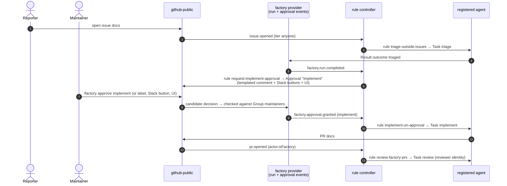
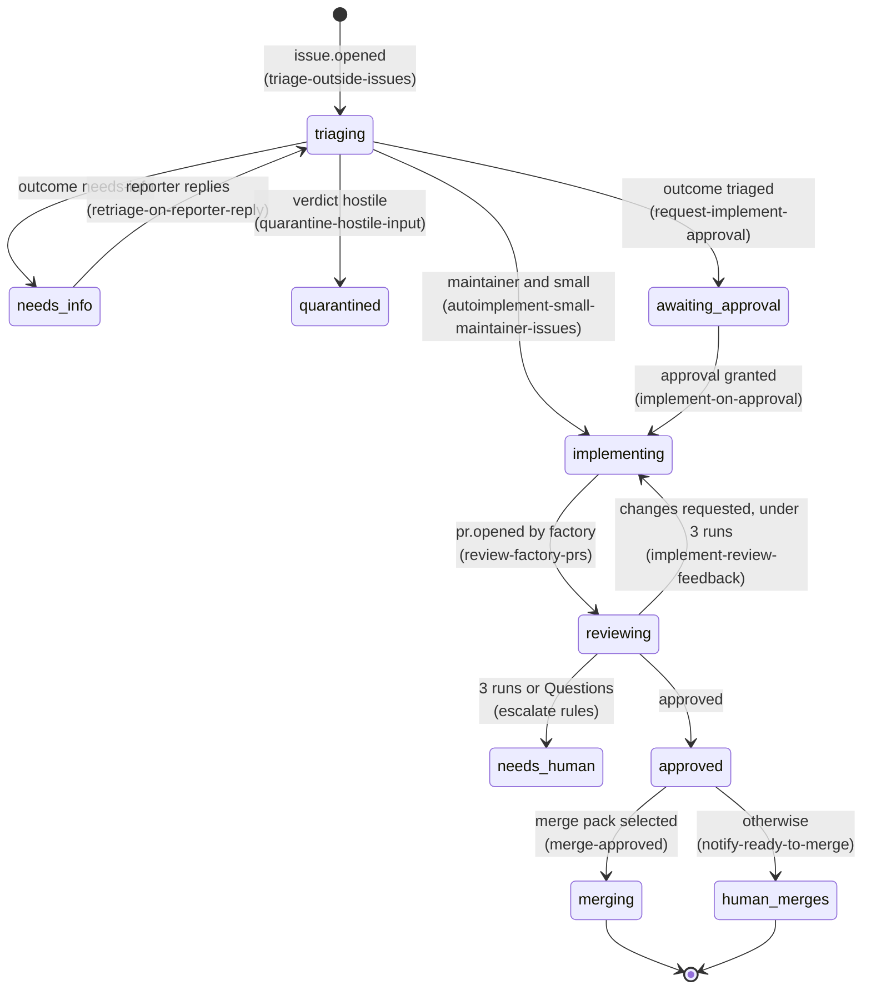

# 04 — Rules in practice: cascades and example rule packs

> Status: **draft for discussion** · Last updated: 2026-10-15

The engine has **no built-in flows** (P10). Everything here is **catalog content**: rules grouped into packs (by the `pack` label), selected by RuleSets. Field semantics are in [03](03-domain-model.md#rule).

## How rules cascade

There is no "next step" field. **Every step ends by producing an event**, and the next rule matches that event. Three kinds of event drive cascades:

| Event source | Example | Used for |
|---|---|---|
| **Factory events** (`factory` provider) | `factory.run.completed` with `run.spec == 'triage' && run.outcome == 'triaged'` | Chaining on what an agent concluded |
| **Approvals** (`factory` provider) | `factory.approval.granted` with `approval.name == 'implement'` | Human gates, whether the human answered in the UI, Slack or GitHub |
| **Provider events** (GitHub, Slack) | `pr.opened` with `actor.isFactory`, `pr.review.submitted` | Reacting to what actually happened on the provider, including the factory's own effects echoing back |

Your example, **triage → approve triage → implement → review**, is four rules:

```yaml
# rules/intake/triage-outside-issues.yaml
kind: Rule
metadata: { name: triage-outside-issues, labels: { pack: intake } }
spec:
  providerSelector: { matchLabels: { family: github } }
  on: [issue.opened]
  where: "actor.tier in ['anyone', 'contributor'] && !actor.isBot"
  params: { queue: triage }
  actions:
    - dispatch: { taskSpec: triage, queue: "{{ params.queue }}" }
    - set: { triage: running }
---
# rules/implement/request-implement-approval.yaml
kind: Rule
metadata: { name: request-implement-approval, labels: { pack: implement } }
spec:
  on: [factory.run.completed]               # factory-only: no providerSelector needed
  where: "run.spec == 'triage' && run.outcome == 'triaged'"
  actions:
    - set: { triage: "=run.outcome" }
    - requestApproval:
        name: implement
        approvers: maintainers
        via: [ui, slack, github]
        template: approve-implement
        expires: 7d
---
# rules/implement/implement-on-approval.yaml
kind: Rule
metadata: { name: implement-on-approval, labels: { pack: implement } }
spec:
  on: [factory.approval.granted]
  where: "approval.name == 'implement'"
  actions:
    - dispatch: { taskSpec: implement, queue: default }
    - set: { implement: running }
---
# rules/review/review-factory-prs.yaml
kind: Rule
metadata: { name: review-factory-prs, labels: { pack: review } }
spec:
  providerSelector: { matchLabels: { family: github } }
  on: [pr.opened, pr.updated]
  where: "actor.isFactory && !item.pr.draft"
  params:
    harness: { name: claude-code, config: { model: "claude-sonnet-5-*", reasoningEffort: high } }
  actions:
    - cancel: { taskSpec: review }          # a newer commit supersedes an in-flight review
    - dispatch: { taskSpec: review, queue: default, harness: "{{ params.harness }}" }
```



### Your two options for the human gate and the PR step

- **Label-based approval** (`issue.labeled` with `event.label == 'triage:approved' && actor.tier == 'maintainer'`) works, and is a valid rule. The drawback is that the gate becomes GitHub-specific, and you get no quorum, no expiry, and nothing for Slack or the UI. With the **Approval** resource, a label is still accepted as one channel (`factory:approve-implement`), but rules depend on `factory.approval.granted`, which works the same from every channel. **I recommend Approvals.**
- **"PR opened by the [bot] → review"** is exactly `review-factory-prs`. Two details make it reliable:
  1. The PR is **linked to the same work item automatically**, because the factory opened it through the Effector. So the review run, and every rule after it, sees `item.state.triage`, the approval, and the original issue.
  2. Reacting to the **provider's** `pr.opened` (rather than a factory-internal "effect applied" event) means the same rule also covers PRs that a human opens through a factory identity, and the rule only fires once GitHub has really created the PR.

## Example rule packs

### `intake`

```yaml
- name: triage-maintainer-issues            # pack: intake
  providerSelector: { matchLabels: { family: github } }
  on: [issue.opened]
  where: "actor.tier == 'maintainer'"
  params: { harness: { name: codex, config: { model: "gpt-5*", reasoningEffort: low } } }
  actions: [{ dispatch: { taskSpec: triage, queue: triage, harness: "{{ params.harness }}" } }, { set: { triage: running } }]

- name: retriage-on-reporter-reply           # needs-info loop
  providerSelector: { matchLabels: { family: github } }
  on: [issue.commented]
  where: "item.state.triage == 'needs-info' && actor.id == item.reporter.id"
  actions: [{ dispatch: { taskSpec: triage, queue: triage } }, { set: { triage: running } }]

- name: quarantine-hostile-input
  on: [factory.run.completed]
  priority: 100
  final: true
  where: "run.spec == 'triage' && run.result.verdict.intent in ['abusive', 'prompt-injection']"
  actions:
    - effect: { op: label.add, labels: [factory:quarantined] }
    - notify: { template: quarantine, to: [{ group: maintainers, via: slack-ccf, as: mention }] }
```

### `implement`

```yaml
- name: autoimplement-small-maintainer-issues      # skip the approval for trusted, small work
  on: [factory.run.completed]
  priority: 10
  final: true                                      # suppresses request-implement-approval
  where: >
    run.spec == 'triage' && run.outcome == 'triaged' &&
    item.reporter.tier == 'maintainer' && run.result.verdict.size in ['xs', 's']
  actions: [{ dispatch: { taskSpec: implement, queue: default } }, { set: { implement: running } }]

- name: implement-review-feedback
  providerSelector: { matchLabels: { family: github } }
  on: [pr.review.submitted]
  where: "event.review.state == 'changes_requested' && item.pr.author.isFactory && item.count('implement') < params.maxImplementRuns"
  params: { maxImplementRuns: 3 }
  actions: [{ dispatch: { taskSpec: implement, queue: default, context: [event.review] } }]

- name: escalate-implement-loop
  providerSelector: { matchLabels: { family: github } }
  on: [pr.review.submitted]
  where: "event.review.state == 'changes_requested' && item.count('implement') >= params.maxImplementRuns"
  params: { maxImplementRuns: 3 }
  actions:
    - effect: { op: label.add, labels: [needs-human] }
    - notify: { template: needs-human, to: [{ item: all }, { group: maintainers, via: slack-ccf, as: mention }] }
```

### `review`

The pack contains `review-factory-prs` (above) plus:

```yaml
- name: review-human-prs-on-request
  providerSelector: { matchLabels: { family: github } }
  on: [issue.commented, pr.labeled]
  where: >
    !item.pr.author.isFactory && actor.tier == 'maintainer' &&
    (event.text.startsWith('/factory review') || event.label == 'factory:review')
  actions: [{ dispatch: { taskSpec: review, queue: default } }]

- name: escalate-review-questions
  on: [factory.run.completed]
  where: "run.spec == 'review' && run.outcome == 'needs-human'"
  actions: [{ effect: { op: label.add, labels: [needs-human] } }]

- name: notify-ready-to-merge
  providerSelector: { matchLabels: { family: github } }
  on: [pr.review.submitted]
  where: "event.review.state == 'approved' && actor.identity == 'reviewer'"
  actions: [{ notify: { template: ready-to-merge, to: [{ channel: { provider: slack-ccf, name: "#ccf-docs" } }] } }]
```

### `merge` (dark factory, opt-in)

```yaml
- name: merge-approved
  providerSelector: { matchLabels: { family: github } }
  on: [pr.review.submitted, pr.checks.completed, factory.workitem.resynced]
  where: >
    item.pr.approvedBy.exists(a, a.identity == 'reviewer' && a.commit == item.pr.head) &&
    item.pr.checks.state == 'success' && item.pr.unresolvedThreads == 0 &&
    !('do-not-merge' in item.pr.labels)
  actions: [{ dispatch: { taskSpec: merge, queue: default } }]

- name: rereview-after-nontrivial-rebase
  on: [factory.run.completed]
  where: "run.spec == 'merge' && run.outcome == 'rebased-with-conflicts'"
  actions: [{ dispatch: { taskSpec: review, queue: default } }]
```

The **rule** decides *whether* to try a merge. The **`merge` task spec** decides *how* to do it safely: re-verify the gates, scan late human comments, rebase or send the PR back to review, then merge or add the repo's merge label.

### `release-docs`

```yaml
- name: docs-on-release
  providerSelector: { matchLabels: { family: github } }
  on: [release.published]
  where: "event.release.conclusion == 'success' && !event.release.semver.prerelease"
  debounce: { window: 2h, key: "event.release.train" }    # one docs PR per release train
  params: { docsRepo: compliance-framework/docs }
  actions:
    - dispatch:
        taskSpec: release-docs
        queue: default
        target: { repo: "{{ params.docsRepo }}" }          # event from api/ui/…, work in docs
        context: [event.release.notes, event.release.compare]
```

Because the *event* comes from the releasing repo and the *work* happens in `docs`, the RuleSet that selects this rule scopes the **sources**. The `docs-releases` RuleSet below does that.

### `slack-intake`

```yaml
- name: slack-intake
  providerSelector: { matchLabels: { family: slack } }
  on: [message.mention]
  actions: [{ dispatch: { taskSpec: triage, queue: triage } }, { set: { triage: running } }]

- name: promote-slack-to-issue
  on: [factory.run.completed]
  where: "run.spec == 'triage' && run.outcome == 'promote'"
  params: { issueRepo: compliance-framework/docs, issueProvider: github-public }
  actions:
    - effect: { op: create-issue, provider: "{{ params.issueProvider }}", repo: "{{ params.issueRepo }}", from: run.result.issueDraft }
    - link: { from: "=effect.result" }
    - notify: { template: tracked-as, to: [{ item: threads }] }
```

## RuleSets for `docs`

```yaml
kind: RuleSet
metadata: { name: docs }
spec:
  providerSelector: { matchLabels: { family: github, network: public } }
  scope: { repos: ["compliance-framework/docs"] }
  rules:
    selector: { matchExpressions: [{ key: pack, operator: In, values: [intake, implement, review] }] }   # + merge → dark factory
  overrides:
    implement-review-feedback: { maxImplementRuns: 3 }
    escalate-implement-loop: { maxImplementRuns: 3 }
  budget: { daily: { runs: 60 } }
  stateKeys: [triage, implement, review, merge]
---
kind: RuleSet
metadata: { name: docs-releases }
spec:
  providerSelector: { matchLabels: { family: github, network: public } }
  scope: { repos: ["compliance-framework/{api,ui,agent,helm-charts}", "compliance-framework/plugin-*"] }
  rules: { refs: [docs-on-release] }
---
kind: RuleSet
metadata: { name: docs-slack }
spec:
  providerSelector: { matchLabels: { family: slack } }
  scope: { channels: ["#ccf-docs"] }
  rules: { selector: { matchLabels: { pack: slack-intake } } }
```

### What these rules produce for one issue

This is an **emergent** view drawn from the rules above. It isn't configuration.



## Conventions and tooling

- **State keys** are free-form, one per task spec by convention. RuleSets declare `stateKeys` so CI catches typos.
- **Labels are effects, not state.** If humans should see a state on GitHub, a rule adds the label. The marker comment always carries the full state for rebuild ([02](02-architecture.md#db-and-queue)).
- **Groups and templates** are catalog kinds ([03](03-domain-model.md#group)). `maintainers` is defined once and used by trust tiers, notifications and approvals.
- **Engine invariants** (kill switches, budgets, per-item run cap, single active run, dedupe, credentials, effects allow-list) are in [02](02-architecture.md#safety-rails-the-only-engine-invariants). Rules can't disable them.
- **Testing:** `factory rules test` replays recorded events from `catalog/testdata/` and prints which RuleSets and rules match and which actions would run. CI runs it on every catalog PR and **diffs the decisions** against `main`.
- **Explaining:** the UI and `factory explain <work item>` show the RuleSet, rule, `where` inputs and rail verdicts for every decision.
