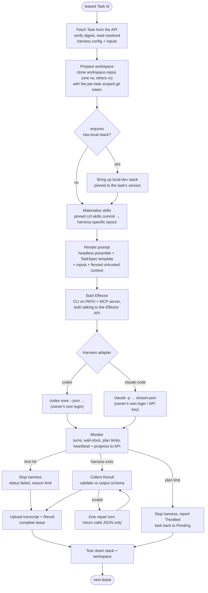
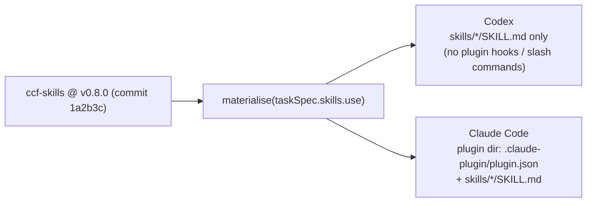

# 05 — Agent runtime: the thin overlay

> Status: **draft for discussion** · Last updated: 2026-10-15

`factory-agent` is the **only** code that runs next to the LLM. It turns a leased `Task` into a correctly configured, sandboxed harness run, and turns the harness output into a validated `Result`. It holds **no role knowledge**: every behavioural detail comes from the Task, which was compiled from a TaskSpec and the rule that dispatched it.

It has two modes:

| Mode | Used by | What it does |
|---|---|---|
| `factory-agent worker` | **Registered pools (PoC)** | Registers with the dispatcher, long-polls for leases, runs tasks one after another, heartbeats, and reports throttling. The protocol is in [10](10-poc.md#agent-lifecycle-and-lease-protocol). |
| `factory-agent run --task <id>` | Ephemeral pools (later) | Runs exactly one task and exits. It's launched by a pool backend (an Actions job, a pod). |

Both modes share the run pipeline below.

## Run lifecycle



There's **no LLM-credential step**. The harness uses the agent's own local authentication: owner-signed-in subscriptions in the PoC, and org API keys for Claude beyond it. The Task only says `llm: agent-local` ([ADR-0008](adr/0008-llm-auth-stays-with-the-agent.md)).

## Harness adapter contract

```go
type Adapter interface {
    Name() string                                              // "codex" | "claude-code"
    // Probe reports what this machine can run: version, auth mode, models and efforts it offers.
    // The worker sends it to the dispatcher at registration (the agent's capability "offer").
    Probe(ctx context.Context, local LocalConfig) (Capabilities, error)
    Prepare(ctx context.Context, ws Workspace, t Task) error   // skills, config files, MCP wiring
    Run(ctx context.Context, ws Workspace, t Task, prompt string, sink EventSink) (RawOutput, error)
}
// EventSink receives normalised progress events (turn, tool call, tokens, rate-limit signals)
// for the monitor and the API, whatever the harness's native stream format.
```

Each adapter maps the same Task fields to its harness. Every value comes from `task.harness.resolved`, the concrete result of [pattern resolution](03-domain-model.md#patterns-in-harness-config), never from the raw request.

| Task field | Codex adapter | Claude Code adapter |
|---|---|---|
| Invocation | `codex exec`, `--json` (JSONL events) | `claude -p`, `--output-format stream-json` |
| Model | `-m <resolved.model>` | `--model <resolved.model>` |
| Reasoning effort | `-c model_reasoning_effort=<resolved.reasoningEffort>` | Mapped to Claude Code's effort or thinking setting (flag or settings key to verify) |
| Auth (PoC) | Owner's `codex login`, in a **dedicated `CODEX_HOME`** | Owner's subscription login, in a **dedicated `CLAUDE_CONFIG_DIR`** (verify) |
| Auth (beyond the PoC) | API key or Enterprise access token (Q15) | `ANTHROPIC_API_KEY` in the worker's environment |
| System / TaskSpec prompt | `AGENTS.md` in the scratch `CODEX_HOME`, prompt on stdin | `--append-system-prompt` (headless preamble), prompt on stdin |
| Skills | `SKILL.md` folders copied into the scratch Codex skills dir (path to verify) | `--plugin-dir <materialised ccf-skills plugin>` |
| Workspace mode | `--sandbox read-only \| workspace-write`, `--ask-for-approval never` (flags to verify) | `--permission-mode`, `--disallowedTools`, a `PreToolUse` hook that enforces the workspace mode |
| Effector | `[mcp_servers]` in the scratch `config.toml`; CLI on `PATH` | `--mcp-config` → factory MCP server; CLI on `PATH` |
| Structured result | `--output-schema <file>` (to verify) | `--json-schema <output.schema>` |
| Limits | Turns and wall-clock enforced by the runner from the JSONL stream | `--max-turns`; wall-clock by the runner. `--max-budget-usd` only applies with API keys. |
| Isolation from personal config | Scratch `CODEX_HOME` per worker; per-task skills and config | No personal `~/.claude`; explicit `--settings`; consider `--bare` plus explicit plugin dir (verify) |

> **Why drive the CLIs rather than the Claude Agent SDK?**
> - **Auth:** the unmodified CLI, signed in by its owner, is the sanctioned way to use a subscription. The Agent SDK is meant for products, which use API keys.
> - **Symmetry:** the runner is Go (like `workflows`, `api` and `agent`), and driving both harnesses as headless CLIs keeps the two adapters symmetric and thin.
>
> The adapter seam still allows an SDK-based Claude adapter for API-key agents later.
>
> **Why not `claude-code-action` / `codex-action`?** Each one fuses dispatch, runtime and harness, configured per vendor, and runs on Actions. Using them would express TaskSpecs twice, and they don't fit registered agents. See [06](06-technology-options.md#anthropic-and-openai-building-blocks).

## Skills: one source, two harnesses

`ccf-skills` is a **Claude Code plugin marketplace**. Its skills are `SKILL.md` folders, the open Agent Skills format that Codex also reads. Each TaskSpec pins `ccf-skills` to a **tag**, and the task compiler resolves it to a **commit**. The adapter then lays the selected skills out for its harness:



Portability rules, since Codex is the default harness and Claude Code reviews:

- Keep the logic in **`SKILL.md` plus scripts** (bash/python). Don't depend on Claude-only plugin features: hooks, slash commands, `AskUserQuestion`, `CronCreate`, subagents.
- Put deterministic operations in **CLIs** (as `lisa`, `ccfr` and `local-dev`'s `make` targets already do). Both harnesses can run a CLI.
- Where a skill must branch per harness, it reads `FACTORY_HARNESS`.

### Making `ccf-skills` headless-friendly

Several skills assume a human at the keyboard. `bugreport`, `bugfix` and `resolve` have steps like "ask me to verify" and "wait for the user to confirm", and `lisa` owns its own watch loop through `CronCreate`. In the factory:

Skills change in place and **backwards-compatibly** (Q8): the headless behaviour only switches on with `FACTORY_HEADLESS=1`, so interactive use is unchanged.

1. **Headless preamble.** The runner sets `FACTORY_HEADLESS=1` and always prepends this to the prompt: *"You are running unattended inside CCF Factory. Never wait for a human. Where a skill asks to confirm with the user, decide yourself if the action is within your task's effects; otherwise stop and return `status: needs_input` with the question. If the run's environment stops you, return `status: failed` with what failed; outcomes such as `blocked` are for the work itself."*
2. **`needs_input` is just an outcome.** It arrives as `factory.run.completed` with `run.result.question`, and **rules** decide what happens. Typically that's a `requestApproval` or a `notify` to the work item, after which the human's answer triggers a new run. No agent sits idle waiting.
3. **Loops move to rules.** `lisa`'s "watch PR until approved" loop becomes rules on `pr.review.submitted` and `factory.run.completed` ([04](04-flows.md)). The factory always calls `lisa` **one-shot**, including for stacks.
4. **Tickets are GitHub Issues** (Q7). The skills read and write `./tickets/{ID}.md`. In headless mode the runner writes the issue (or sub-issue) body and thread there, keyed by the GitHub issue reference, and maps the result back. Jira-style IDs keep working interactively.
5. **New skills for the PoC:** `docs-release`, `docs-style`, `docs-gif`, `docs-verify`, `plan-epic` and `merge` ([10](10-poc.md#what-the-poc-adds-to-the-model)).

## The Effector

The Effector is the agent's **only** channel to change things on providers. It grows out of the existing `lisa` CLI (`pr create`, `thread reply`, `label add`, `stack …`). It's exposed two ways, and **both call the dispatcher's Effector API**, never GitHub directly:

- as a **CLI** on `PATH`: `factory pr open …`, `factory pr comment …`, `factory label add …`, `factory stack push …`, `factory result …`;
- as an **MCP server** with the same operations as typed tools, for harnesses that prefer tools over shell.

The API checks every call against the Task's `effects.allow` and label globs, records it as an `Effect` on the work item, and applies it through the Provider adapter under the TaskSpec's **identity** (`author` or `reviewer` App). Every call carries an **idempotency key** (task id plus sequence number), so a retried task never double-posts.

Git pushes are the one thing done from the workspace, using the per-task token (write on one repo only). A jailbroken model that bypasses the Effector and calls `gh` or `curl` directly is still limited by that token's scope, plus the sandbox's egress rules.

The dispatcher, not the agent, writes the marker comments that tie artefacts to tasks:

```markdown
<!-- factory:task tsk_01JA… spec=release-docs harness=codex/gpt-5-codex agent=agt_gus-mbp-01 -->
```

## Local stack and GIF tooling

TaskSpecs that check claims or record media declare `requires.labels`, and only agents that offer those labels get leased those tasks:

| Label | Agent provides | Used by |
|---|---|---|
| `has-local-stack` | Docker, a `compliance-framework/local-dev` checkout, enough RAM and CPU for the compose stack | `release-docs` (depth `full`), `docs-review` (with `verifyAgainst`) |
| `gif-tooling` | Playwright with browsers, `gifski`/`ffmpeg`, `vhs` | `release-docs` (depth `full`) |

**Stack lifecycle per task:**

1. Bring the stack up pinned to the task's version, through `local-dev`'s environment overrides (`CCF_API_IMAGE`, `CCF_AGENT_VERSION`, …) and `make demo-up-showcase` for realistic seeded data.
2. Wait for health.
3. Run the task.
4. Tear the stack down, including volumes.

One stack at a time per agent (`has-local-stack` tasks force concurrency 1 on that agent) to avoid port clashes. GIFs follow `STYLE.md` limits (size, length, resolution) and land under `static/img/<instance>/<line>/` (the docs instance and its minor line; [docs-revamp.md](workstreams/docs-revamp/LLD/docs-revamp.md), [local-stack.md](workstreams/agent/LLD/local-stack.md#media-constraints-from-docs-stylemd-enforced-by-skills)). The stack itself is pipeline-managed: skills only read it (`factory-agent stack env|wait`).

## Sandbox and workspace

| Concern | PoC (registered agent on a personal machine) | Later (ephemeral, k8s) |
|---|---|---|
| Isolation | Dedicated OS user or devcontainer for the worker; scratch workspace per task, deleted afterwards. Details in [10](10-poc.md#isolation-on-a-personal-machine). | Pod per run under gVisor (Agent Sandbox `SandboxClaim`), or a microVM |
| Filesystem | Only `workspace.repos` are cloned. `ro` repos are read-only (permission mode, or the hook denies writes). | Same, via emptyDir |
| Network egress | `sandbox-runtime` (`srt`) or container egress allow-list: GitHub, the LLM vendor, registries, `localhost` for the stack | NetworkPolicy plus egress proxy allow-list |
| Credentials | Per-task git token in memory only. LLM auth is the agent's own. No provider keys on the machine. | Same; API keys for ephemeral pools projected into the agent process only |
| Wall-clock | Runner-enforced `limits.maxWallClock`; lease TTL as a backstop | Plus `activeDeadlineSeconds` |

## Observability and evaluation

- **State:** Tasks and Runs live in the dispatcher's store: spec, harness, **effective config**, auth mode, agent and owner, turns, tokens, cost when there is one, outcome, effects. That data drives budgets and the UI. In the PoC's in-memory store, history is lost on restart. The worker also keeps a local copy of its own runs.
- **Progress and traces:** the runner streams normalised progress (SSE in the UI) and can emit OpenTelemetry spans (task → run → turns → tool calls). Claude Code exports OTel natively; Codex spans are derived from its JSONL stream.
- **Transcripts:** uploaded per run (redacted) for debugging and eval sets.
- **Evals:** build a **replay corpus** from past `docs` releases and issues, and run each TaskSpec on both harnesses offline. Score:
  - release-docs build-pass rate and human edit distance;
  - review findings against `ccf-review` calibration cases (`ccf-review:rules` has a calibrate mode);
  - accuracy of version claims.

  The harness choice per TaskSpec then becomes a data-driven **RuleSet override** or a sampling rule, never a code change.
