# 06 — Technology options

> Status: **draft for discussion** · Researched 2026-10-15. Projects in this space change monthly, so re-verify before committing. Items marked **(unverified)** could not be confirmed from a primary source.

The question isn't "which platform is the factory?" It's **which layer does each piece fill?**

```mermaid
flowchart LR
    subgraph Ingress
        i1["GitHub App webhooks"]
        i2["Slack Bolt / Socket Mode"]
        i3["Argo Events"]
        i4["Hookdeck"]
    end
    subgraph Dispatch["Dispatch + durability"]
        d1["Own Go dispatcher<br/>+ Postgres (River)"]
        d2["Temporal / Hatchet /<br/>Inngest / Restate"]
        d3["Argo Sensors"]
        d4["GitHub Actions<br/>router workflow"]
    end
    subgraph Runtime["Runtime / sandbox"]
        r1["GH Actions runners"]
        r2["k8s Job + Agent Sandbox"]
        r3["agent-orca AgentRun"]
        r4["kagent Agent"]
        r5["Claude Managed Agents"]
        r6["E2B / Daytona / Modal"]
    end
    subgraph Harness
        h1["Claude Code CLI / Agent SDK"]
        h2["Codex CLI"]
        h3["claude-code-action /<br/>codex-action"]
    end
    Ingress --> Dispatch --> Runtime --> Harness
```

Some products also span **all** layers (Open SWE, OpenHands, Copilot Agent HQ, Claude Tag). They're assessed separately under [buy vs build](#end-to-end-products-buy-vs-build).

---

## agent-orca (heddles/agent-orca)

You flagged this one. I read the repo (README, `docs/agent-images.md`, `docs/agentworkflow.md`, `api/v1alpha1/*`).

**What it is.** A Kubernetes operator (Go, Apache-2.0, Helm) where agents are CRDs: `ModelProvider` → `ModelSelector` → `Agent` (template) → `AgentRun` (one-shot pod) / `AgentDeployment` (long-running, fed by chat, queue, pubsub or loop) / `AgentWorkflow` (a CEL-conditioned DAG of runs with a workflow-wide `budgetCap`). It also has `Tool`, `MCPServer`, `KnowledgeBase` (Qdrant RAG), `GuardrailPolicy` and `TenantConfig`, plus an External Task API, an ACP API, a UI, Redis checkpoints and Postgres archival. Repo created 2026-09-26, 84★, v0.4.x, last push 2026-10-13.

**Does "the dispatcher's job is creating a manifest" hold?** Yes, structurally. Our dispatcher would `kubectl apply` an `AgentRun{agentRef: triage, input: …}` per Task. Lifecycle tools (`_done`/`_fail`/`_clarify`/`_handoff`) map cleanly onto our Result statuses. That's why the [Result contract](03-domain-model.md#result) borrows them.

**The mismatch.** agent-orca's pod model is *thin client, smart router*:

- The agent image must **speak OpenAI chat completions** to a **model-router sidecar**.
- The router **executes tool calls server-side**, injects the system prompt and tools from the CR, and owns checkpoints, spend and guardrails.

Claude Code and Codex are the opposite. They're *thick* agent loops that run their own tools (shell, file edits, git) **inside the workspace**, and they talk to their vendors' native APIs. The docs say an Anthropic-native image is "lower priority" and would need `framework: shim` or a manual base URL. Running Claude Code or Codex on orca means:

- bypassing the router, which removes most of orca's value (cost tracking, guardrails, checkpoints);
- or forcing the harnesses through an OpenAI-compatible proxy whose server-side tool execution conflicts with the harness's own tools **(unverified in practice; likely to break)**.

`AgentWorkflow` is a static DAG with a wall-clock timeout. Our rule cascades wait days on humans and approvals (see [04](04-flows.md)), which it doesn't model. And there's no git-workspace concept.

| Pros | Cons |
|---|---|
| Manifest-first, k8s-native, Apache-2.0 | Three weeks old, v1alpha1, few contributors |
| Built-in cost tracking, budgets, guardrails, warm pools, MCP access control | Agent contract is "OpenAI chat client". It doesn't fit Claude Code or Codex. |
| `AgentRun` / `AgentWorkflow` / lifecycle tools are a good conceptual model | Router-side tool execution conflicts with harness-side tools |
| External Task API for programmatic submit | No workspace or git model. Heavy footprint (Redis, Postgres, Qdrant, operator). |

**Verdict: don't adopt now. Borrow the concepts and keep a door open.** Our `Task` → backend seam means an `agent-orca` backend can be added later if orca gains a "bring-your-own-harness" mode. Worth watching; maybe open an issue upstream describing our use case.

---

## Kubernetes-native agent platforms

### kagent (CNCF Sandbox, Solo.io)
- **What:** k8s operator. `Agent` CRD (`api.kagent.dev/v1alpha3`) with `systemPrompt`, `modelConfig`, MCP `tools`, and **`plugins` from git with pinned commit plus a skills list**. Has a **`Harness` kind with a Claude Code harness** (drives `claude -p` stream-json). Exposes agents over A2A. v1.0.0-alpha13 (2026-10-13).
- **Fit:** the closest off-the-shelf match to "a manifest per TaskSpec, Claude Code plus git-pinned plugin". The dispatcher would send an A2A task to `Agent/triage`.
- **Pros:** CNCF, active, Claude harness exists, plugin and skills pinning is first-class, human approval for MCP calls.
- **Cons:** alpha API churn. Oriented to long-lived agents rather than a fresh pod per task. **No Codex harness (unverified)**. Permission mode is not yet settable in the CRD.
- **Verdict:** the strongest k8s candidate for a **registered-agent backend** in future work. Re-evaluate when it reaches 1.0 GA.

### Agent Sandbox (kubernetes-sigs/agent-sandbox)
- **What:** `Sandbox`, `SandboxTemplate`, `SandboxClaim` and `SandboxWarmPool` CRDs. Pluggable isolation (gVisor or Kata). v1.0.6. Has an official recipe for Claude Managed Agents self-hosted workers.
- **Fit:** an **ephemeral execution substrate**, with no opinion on the agent. "Dispatcher creates a `SandboxClaim` running `factory-agent` with the Task" is the clean k8s pattern.
- **Verdict:** **recommended k8s runtime backend** if ephemeral pools on Kubernetes are ever needed (future work).

### Dapr Agents
- Its own Python agent framework with durable workflows and pub/sub. It isn't a harness wrapper. Only relevant if we pick Dapr for plumbing; **not recommended**.

---

## Anthropic and OpenAI building blocks

| Option | What | Fit | Pros | Cons |
|---|---|---|---|---|
| **Claude Code headless** (`claude -p`) | Full harness, scriptable | **Claude adapter (recommended)**: the reviewer and validation harness. PoC on owners' subscriptions, API keys beyond. | Same harness humans use with `ccf-skills`. `--plugin-dir`, `--json-schema`, stream-json. The unmodified, owner-signed-in CLI is the sanctioned way to use a subscription. | Need hermetic config. Flag behaviour evolves (`--bare` defaulting). |
| **Claude Agent SDK** (TS / Python) | Programmable harness | Alternative Claude adapter for API-key agents (beyond the PoC) | Hooks, permission callbacks, `plugins`, `maxBudgetUsd` in code | Not Go. Commercial terms. API-key auth only (no subscriptions). |
| **Codex CLI** (`codex exec`) | Codex harness, headless | **Codex adapter (recommended)**: the **default harness**, on owners' ChatGPT plans | Reads `SKILL.md` skills and `AGENTS.md`. JSONL output. Built-in sandbox modes. | Flag names changed in 2026 (`sandbox` → `permission-profile` in the action); verify before pinning |
| **claude-code-action** | Claude Code inside Actions, `@claude` mentions | Not used | Zero infra. `plugin_marketplaces` + `plugins` inputs. | Fuses dispatch, runtime and harness. Claude-only. TaskSpecs get re-expressed as workflow YAML. Doesn't fit registered agents. |
| **codex-action** | Codex inside Actions | Not used | Same | Same, Codex-only. Must use `drop-sudo` / unprivileged mode to protect the key. |
| **Claude Managed Agents** (beta) | Hosted harness: `ant apply` agent manifests, sessions with `github_repository` resources, budgets, webhooks; self-hosted workers | Possible future backend | Declarative agents in git, hosted sandboxes, per-session budget | Beta. Claude-only. Plugins must be repackaged as Skills API skills plus MCP. **No inbound GitHub/Slack triggers**, so we still need our dispatcher. |
| **Routines** (research preview) | Scheduled or API-fired cloud agents | No | Simple | Tied to one claude.ai account. PR/release events only. Rate-limited. |
| **Claude Tag** (Claude in Slack) | @Claude in Slack → sandboxed task → draft PR | No (it competes with our Slack ingress) | Instant Slack UX | We'd lose control of rules, runtime and identity |

---

## Dispatch and durability

The dispatcher owns its state (ADR-0001): work items, tasks and runs in a store that starts **in-memory** and is rebuilt from provider projections. Decisions are recomputed on every event (P4). What it needs is:

- deduplication per (event, rule),
- a per-(work item, task spec) lock,
- a task queue with **leases** for registered agents (long-poll, heartbeat, expiry),
- debounce timers,
- a watchable resource store.

That's a **job queue plus a table**, not a workflow engine.

| Option | Fit | Pros | Cons | Verdict |
|---|---|---|---|---|
| **Own Go dispatcher, in-memory store** | Exactly the needs above, with no durability | Zero dependencies; one binary on a laptop or VM | History lost on restart (state itself is rebuilt) | **PoC** ([ADR-0005](adr/0005-poc-plain-go-binary-registered-agents.md)) |
| **Same, on Postgres** (e.g. **River** job queue, SKIP LOCKED) | The durable version | Go like the rest of CCF; leases and unique jobs built in | One database to run | Future (durable) |
| **GitHub Actions as dispatcher** (caller workflow → `factory route` CLI → `workflow_dispatch`) | — | Zero infra | Needs per-repo caller files (breaks P6). Nowhere to keep state. No registered agents. | Rejected |
| **Temporal** | Long human-in-the-loop sagas; its workers pull from task queues | Strongest durability, signals, timers | Heavy ops. Duplicates the factory's own state model and rule layer. | Not now. Revisit if cascades need complex compensation. |
| **Hatchet / Inngest / Restate** | Durable steps plus queues | Lighter than Temporal; Inngest `waitForEvent` is nice | Another platform to run. Same duplication of state. | Viable alternatives to River |
| **Argo Events + Argo Workflows** | "Manifest-native" dispatcher on k8s | GitHub and Slack EventSources, Sensors create any resource (e.g. a `SandboxClaim`), CNCF graduated | Sensor filters are too weak for our rules (CEL over work-item state, RuleSets, factory events). Requires k8s. | Possible **ingress** in future work, not the brain |
| **Tekton Triggers** | Like Argo, CI-flavoured | — | Same limits | No |

---

## Ingress

- **GitHub:** a single org-level **GitHub App** is the right long-term source (one webhook for all repos, fine-grained permissions, installation tokens). Use Hookdeck or a similar gateway if we want hosted retries and replay. Use Smee only for dev.
- **Slack:** **Bolt** with **Socket Mode** (no public endpoint, which suits a cluster or laptop) at first. Move to the Events API over HTTP if we publish the app. The current `workflows` Slack app is post-only (`chat:write`); intake needs `app_mentions:read` and `channels:history` on allow-listed channels.
- **Envelope:** **CloudEvents 1.0** as the internal event format (Argo emits it natively, so a later switch is cheap).

---

## Runtime / sandbox

| Option | Isolation | Ops | Startup | Fit |
|---|---|---|---|---|
| **Registered agents** (our lease API) | Owner's machine: dedicated user/devcontainer + `srt` | Owners run `factory-agent worker` | Instant (warm) | **PoC default**, the only pool ([10](10-poc.md)) |
| **GitHub-hosted runners** | Fresh VM per job | None | ~20–60 s | Future ephemeral pool (API keys) |
| Self-hosted ARC runners | Pod per job | k8s | Fast with warm pool | Bridge to k8s |
| **k8s Job + Agent Sandbox (gVisor)** | Strong, NetworkPolicy egress | k8s | Fast with `SandboxWarmPool` | Future, if Kubernetes |
| E2B / Daytona / Modal | microVM / container, hosted | Low | Fast | Option if we want hosted sandboxes without k8s |
| Claude Managed Agents cloud env | Anthropic-hosted | None | Fast | Claude-only; see above |
| Anthropic `sandbox-runtime` (`srt`) | Process-level FS and network allow-list (shares the kernel) | None | Instant | **Inner layer** around the harness on any runtime |

---

## End-to-end products (buy vs build)

| Product | What it gives | Why not (as the factory) | What to take from it |
|---|---|---|---|
| **Open SWE** (LangChain, MIT) | "Open-source software factory": GitHub, Slack and Linear triggers, PR review, CI babysitting, sandboxes | Harness is Deep Agents, not Claude Code or Codex. Production server needs a license key. Not accepting contributions. | **Best reference architecture** to study (trigger → task → sandbox → PR loop) |
| **OpenHands** (MIT core) | Control center running OpenHands, Claude Code, Codex or any ACP agent. Enterprise tier adds GitHub/Slack/Jira triggers. | Triggers and RBAC are enterprise-tier. Rules and TaskSpecs would live in its UI, not our catalog. | ACP as a possible future adapter protocol |
| **GitHub Copilot Agent HQ** | Assign an issue to Copilot, Claude or Codex. Custom agents in `.github/agents`. | Harness, skills and limits are GitHub-controlled. No central rule layer. No Slack. | Useful for humans in parallel. Not our dispatcher. |
| **Claude Tag / Routines** | Anthropic-hosted triggers | See above | — |
| **CodeRabbit / Kodus** | PR review | Review only. Doesn't use our `ccf-review` rule catalog. | Benchmark for the `docs-review` TaskSpec |

**Conclusion: build the thin parts, buy the heavy parts.** We build the catalog, rule engine, lease API, Effector and runner, which are small and CCF-specific. We buy the harnesses (Codex, Claude Code), the sandboxes (`srt` and devcontainers → Actions VMs → Agent Sandbox) and, once durable, the queue (Postgres/River).

---

## Recommendation summary

| Layer | PoC (two use cases, [10](10-poc.md)) | Future: durable and wider (not planned) | Future: scale (not planned) |
|---|---|---|---|
| Ingress | Org GitHub App webhook (through a tunnel); `github-public` only | + Slack Socket Mode, GHE if needed | Same (optionally Argo Events) |
| Dispatcher | One Go binary: API, in-memory store and queues, controllers, minimal UI | Same on Postgres (River); HA possible | HA; config kinds optionally as CRDs |
| Pools | **Registered only**: `factory-agent worker` on maintainers' machines | + ephemeral `actions-ephemeral` (API keys) | + Agent Sandbox (gVisor) with warm pools; optional kagent / agent-orca backends |
| Harness | **Codex** (default, owners' plans) + **Claude Code** (reviewer and validation; owners' subscriptions in the PoC) | Claude on org API keys | Same |
| Effector | `lisa` CLI evolved into `factory …` + MCP, via the Effector API | Same | Same |

## Sources

- agent-orca: <https://github.com/heddles/agent-orca> (`README.md`, `docs/agent-images.md`, `docs/agentworkflow.md`, `docs/crds.md`)
- kagent: <https://github.com/kagent-dev/kagent>
- Agent Sandbox: <https://agent-sandbox.sigs.k8s.io>
- Claude Code headless: <https://code.claude.com/docs/en/headless>; Agent SDK: <https://code.claude.com/docs/en/agent-sdk/overview>; GitHub Actions: <https://code.claude.com/docs/en/github-actions>, <https://github.com/anthropics/claude-code-action>; Routines: <https://code.claude.com/docs/en/routines>; plugins for orgs: <https://code.claude.com/docs/en/plugins/org>
- Claude Managed Agents: <https://platform.claude.com/docs/en/managed-agents/overview>
- Claude Tag: <https://claude.com/docs/claude-tag/overview>
- Codex GitHub Action: <https://developers.openai.com/codex/github-action>; Codex skills: <https://developers.openai.com/codex/skills>; third-party guides used for `codex exec` flags (verify): <https://codex.danielvaughan.com/2026/04/19/openai-codex-cli-official-documentation-guide/>, <https://codex.danielvaughan.com/2026/05/22/codex-cli-github-actions-best-practices-limitations-gotchas/>
- Anthropic sandbox-runtime: <https://github.com/anthropics/sandbox-runtime>
- Open SWE: <https://github.com/langchain-ai/open-swe>
- Dapr Agents GA: <https://www.cncf.io/announcements/2026/03/23/general-availability-of-dapr-agents-delivers-production-reliability-for-enterprise-ai/>
- Temporal: <https://temporal.io>
