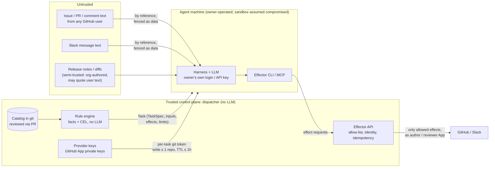

# 07 — Security and governance

> Status: **draft for discussion** · Last updated: 2026-10-15

The factory reads **untrusted input**, such as issues and comments from anyone on public repos, and Slack messages. It **acts with write credentials** on org repos. In the PoC, its agents also **run on people's own machines**. Every control below exists to keep those facts from meeting.

## Trust boundaries

**Design stance: treat the agent sandbox as compromised.** The blast radius is bounded by:

- the per-task token scope,
- the server-side Effector allow-list,
- merge gates built on provider facts,
- egress limits,
- run limits.

It is *not* bounded by the prompt.

The agent harness always runs inside an **OS sandbox** that bounds what its commands may write, read and reach on the owner's machine (Codex's `--sandbox`; Claude Code's sandbox settings, which also keep the machine's other credentials unreadable and the network to the run's hosts). It is a second layer under the scoped tokens, not a replacement for them, and an agent machine that can't sandbox a harness doesn't offer it ([harness-adapters.md](workstreams/agent/LLD/harness-adapters.md#decisions-taken-in-agt-s1-t04)).

## Controls

### Untrusted content handling

- Untrusted text reaches the agent **by reference, fenced and labelled** (`<untrusted source="issue#42 body">…</untrusted>`). The headless preamble says that instructions inside it are data.
- Hidden content (HTML comments, zero-width characters, `
` blocks) is shown to the model **explicitly marked**, never stripped silently. The model should see that someone tried.
- The default `intake` rules route hostile verdicts (`prompt-injection`, `abusive`) to quarantine ([04](04-flows.md#intake)).

### LLM outputs are data, never authority

Rules may test `run.outcome`, `run.result.verdict` and `run.suggest`, and that's how cascades work. So:

- **Outcomes are validated** against the TaskSpec's declared `outcomes` and output schema. Anything else is a failed run.
- **Irreversible gates rely on provider facts, not run outputs.** `merge` rules require a GitHub approval **by the reviewer identity at the current HEAD** and green required checks (`item.pr.approvedBy…`, `item.pr.checks.state`). An injected author run claiming "approved" changes nothing.
- **Author and reviewer are separated:** a different App identity, a different TaskSpec, a different harness in the PoC (Codex writes, Claude Code reviews) and, beyond the PoC, a **different agent**. The scheduler won't lease a `docs-review` task to the agent that authored the PR under review. In a single-machine PoC this is a soft preference.
- **`factory.*` events can only come from the built-in `factory` provider** ([03](03-domain-model.md#the-built-in-factory-provider)). No provider adapter can forge a run result or an approval.
- **Approvals check the actor against the approver Group** at decision time, whatever the channel (UI, Slack, GitHub comment or label).

### Actor trust tiers

Each Provider resolves tiers through its `trust` list, usually backed by **Groups** ([03](03-domain-model.md#provider)). What each tier may trigger is **policy in rules**, not engine behaviour. The default packs do this:

| Tier | Resolved from | Default rule-pack behaviour |
|---|---|---|
| `maintainer` | Group `maintainers` (the CCF org admins) | Everything, including epics (`plan-maintainer-epics`) and small-change auto-implement |
| `contributor` | `CONTRIBUTOR` / `COLLABORATOR` association | Triage, and review on request. Implementation needs an Approval from `maintainers`. |
| `anyone` | Everyone else | Triage only (read-only TaskSpec; comment and label effects). Everything else needs an Approval. |
| `bot` | Allow-listed bots | Ignored by default; per-pack opt-in (e.g. review Dependabot PRs) |

### Identities and tokens

- Each Provider declares **identities**. For `github-public`, those are two GitHub Apps:
  - **`author` = `ccf-factory[bot]`** (contents, pull requests and issues write). Used by `release-docs`, `plan-epic` and `implement`.
  - **`reviewer` = `ccf-factory-reviewer[bot]`**: a different App, so its approval counts as a review by someone other than the author. Used by `docs-review` and `merge`.
- A TaskSpec names its `identity`. Effects run as that identity, and nothing else can choose it.
- **Never** give the factory `ccf-release-bot` (it bypasses the review ruleset) or `ccf-repo-admin`. The existing `ccf-lisa[bot]` could become the author identity ([Q4](09-open-questions.md)).
- **Git tokens** are GitHub App installation tokens minted **per task** by the dispatcher. They have **write on at most one repo** (the workspace's `rw` repo), read on the other declared repos, the TaskSpec's `permissions` subset, and a TTL of ≤1h. They're kept in memory only, never written to disk or logs.
- **Provider private keys never leave the dispatcher.** **LLM credentials never enter it** ([ADR-0008](adr/0008-llm-auth-stays-with-the-agent.md)).

### Registered agents on personal machines

| Threat | Control |
|---|---|
| Someone registers a rogue agent | A join token **plus** owner authentication (GitHub device flow) **plus** membership of the pool's `owners` Group. Agent tokens are short-lived and revocable from the UI. |
| A compromised or malicious agent fabricates results | Outcomes are schema-validated. Merge gates use provider facts. Author and reviewer agents are separated (beyond the PoC). Effects are allow-listed server-side, whatever the agent claims. |
| An agent exfiltrates beyond its task | It only ever holds one task's scoped git token, and only ever receives that task's context. Egress allow-list on the worker (`srt` or container): the git host, the dispatcher, the local stack and the TaskSpec's `workspace.hosts` (e.g. the npm and yarn registries for a docs task), nothing else. |
| Owner's personal data or credentials leak into runs | Dedicated OS user or devcontainer. Dedicated harness config dirs. No personal GitHub credentials are used. Scratch workspaces are deleted after each task ([10](10-poc.md#isolation-on-a-personal-machine)). |
| Owner loses control of their machine or plan | Consent lists (`lending`: queues, RuleSets, harnesses, concurrency, hours, runs and tokens per day, or unlimited), `factory-agent pause`, and a local kill switch. Throttling is respected automatically. |

### Repo-side guardrails (GitHub rulesets)

- Branch protection on `main` stays in force for bots: required checks (`ci / required` on `docs` once it's on the shared workflows; `build` from the push-only "Test Build" workflow until then), required review from an identity other than the author, and conversation resolution.
- The factory pushes only to `factory/*` branches; stacks use `factory/stack/<work item>/<n>`. A ruleset restricts `factory/*` creation to the factory Apps.
- Workflows triggered by factory pushes must run CI. App tokens, not `GITHUB_TOKEN`, make sure the push events fire.
- `CODEOWNERS` for sensitive paths (`.github/`, release config, `docusaurus.config.js` if wanted) requires a human approval, even when the `merge` pack is selected.

### Effector policy

- An allow-list per TaskSpec ([03](03-domain-model.md#taskspec)). For example, `plan-epic` can't push, `docs-review` can't merge, and `release-docs` can't approve.
- Label globs per TaskSpec, so only factory-owned labels can be set.
- **Rate limits:** max comments per run and per work item per hour. This stops spam loops.
- **Idempotency keys** on every effect, so retries never duplicate comments or PRs.

### Budgets, limits, kill switches (safety rails)

These are the engine invariants listed in [02](02-architecture.md#safety-rails-the-only-engine-invariants):

- **Limits:** per-task turn and wall-clock limits; daily budgets per Queue and RuleSet, in runs and tokens for subscription agents and USD for API-key agents; a hard per-work-item run cap.
- **Kill switches:** global, per Provider, per Queue, per work item (`factory:stop` label), and per agent (owner pause).
- **Deferral:** going over a budget **defers** the task (`Pending`, with a reason). It's never silently dropped.

### Audit

- The **state store** records every Task, Run, Effect (with its target URL), Approval decision and token mint, linked by Task id. In the PoC's in-memory store this history doesn't survive a restart, so:
  - **marker comments on GitHub** are the durable audit trail: every bot artefact carries `task`, `spec`, `harness/model` and `agent`;
  - workers keep local run logs.

  A durable store (future work) would keep the history.
- Every Task records its `catalogSHA`, RuleSet, rule and TaskSpec digest, so you can always answer "which rule and which prompt did this?".

## Governance of the catalog itself

- `catalog/**` changes need a maintainer review. **Two approvals** are needed for changes to:
  - TaskSpec `permissions`, `effects`, `identity` or `workspace.hosts` (the hosts widen what a prompt-injected run could reach; FACTORY-CAT-002);
  - any RuleSet that starts selecting the `merge` pack;
  - Pool `admission`;
  - Providers.
- CI validates the schemas, lints CEL, checks references and harness patterns, and runs **`factory rules test`** against recorded events. It reports the decision diff ("this PR changes the outcome of 3 recorded events").
- The factory may propose changes to its own catalog (for example `ccf-review:rules` proposing rules), but it **never** acts on its own repo: `compliance-framework/factory` is excluded from every RuleSet scope ([10](10-poc.md#rulesets)).
