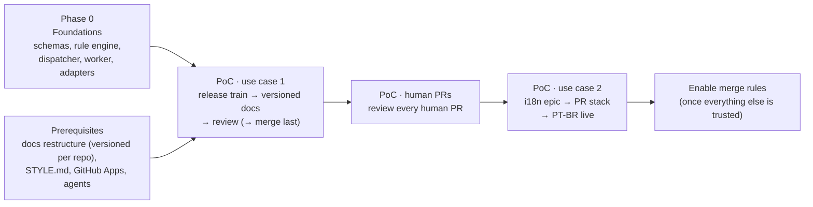

# 08 — Roadmap

> Status: **draft for discussion** · Last updated: 2026-10-15
>
> This roadmap covers **the PoC only** (Q11). The executable breakdown — workstreams, tasks for lisa, and Low Level Designs — is in [workstreams/definitions.md](workstreams/definitions.md). Everything after it is listed under [future work](#future-work-not-planned) and will be planned once the PoC proves the factory's value.

## Phase 0: Foundations

**Repo**

- `LICENSE` (AGPL-3.0, Q14) and a README.

**Catalog and rule engine**

- JSON Schemas for every kind ([03](03-domain-model.md)), and `factory validate`. That covers references, CEL and `=` expressions, harness patterns against adapter capabilities, and `stateKeys`.
- The rule engine as a pure function: *(event, work-item state, catalog) → decisions*. It includes RuleSet scoping and excludes, `priority`/`final`, dedupe and the safety rails. `factory rules test` replays recorded and **fake** webhooks from `catalog/testdata/`. **This is the core, and it's the most important code to get right.**

**Dispatcher (one binary)**

- In-memory `Store` with watch and **90-day retention** for runs and transcripts (Q13).
- Controllers: catalog-sync, provider (GitHub), rule, work-item (projection plus rebuild), scheduler, pool (registered), run.
- API: runner and lease, Effector, resources, commands (including `factory dispatch` to inject a fake event).
- Minimal UI: board, run view, and the "why" view for decisions.

**Agent side**

- `factory-agent worker`: registration, lease long-poll, heartbeat, throttling.
- `codex` and `claude-code` adapters with `Probe`, plus contract tests (a fake harness plus one real smoke run each).
- Effector v0: the `lisa` CLI's GitHub operations behind the Effector API, idempotency keys, marker comments.

**GitHub setup**

- GitHub Apps `ccf-factory` and `ccf-factory-reviewer`, which Gustavo creates and provides (Q4).
- Per-task token minting.

**Exit:** a fake `issue.closed` train event flows through rule → task → local worker → an effect on a sandbox branch, on both harnesses.

## Prerequisites (in parallel with Phase 0)

- **`docs` restructure** (one PR):
  - generated per-repository versioned instances from an `instances.yaml` manifest: **`api` first**, with architecture moved in (Q19, Q20);
  - the catalog landing page in front of per-plugin instances;
  - OpenAPI rendering per version;
  - `STYLE.md` and `docs-map.yaml`;
  - **fake versions** to play with during development (Q10);
  - a required CI check (`test-build`, replaced by `ci / required` when docs moves onto the shared workflows; see the DWF workstream).
- **Skills in `ccf-skills`, changed backwards-compatibly** with headless mode opt-in (Q8):
  - new: `docs-release`, `docs-style`, `docs-gif`, `docs-verify`, `plan-epic`, `merge`;
  - `lisa` one-shot and stack via the Effector;
  - `ccf-review` posting as the reviewer identity.
- **Agents** (Q16): Gustavo's machine (no limits) plus one more maintainer lending what they choose, with Docker, `local-dev`, Playwright, `gifski`, `vhs` and `gh-stack`.

## PoC, use case 1: release train → versioned docs

1. **Develop against fake trains.** Replay fake `train:done` closures, using fake versions in `docs`, until `release-docs` produces the full section set ([10](10-poc.md#versioned-docs-per-repository)) for a patch and a minor release.
2. **Add the review loop:** `docs-review` with `verifyAgainst: train`, plus `fix-release-docs-review`. Seed a wrong `CCF_*` default and check that the review catches it.
3. **Run on a real release train.** Humans still merge, because `merge-release-docs` stays excluded.

**Exit:** success criteria 1 (up to the approved PR), 2, 5, 6 and 7 in [10](10-poc.md#poc-scope).

## PoC, human PRs

- Enable the `poc-docs-human-review` RuleSet.

**Exit:** criterion 4. Every human PR on `docs` gets a factory review, and nothing else happens to it.

## PoC, use case 2: i18n epic

- `plan-epic`, stack building (`build-stack-start`, `build-stack-next`), the stack review and fix loop.
- Effector stack operations (`stack.push`, `stack.rebase`, `pr.retarget`, `sub-issue.add`).

**Exit:** criterion 3 up to an approved stack (merge still by hand).

## Enable merge rules

- Remove `merge-release-docs` and `merge-whole-stack` from the RuleSets' `exclude` lists. That's a catalog PR, which needs two approvals ([07](07-security-and-governance.md#governance-of-the-catalog-itself)).

**Exit:** criteria 1 and 3 in full. Docs PRs merge themselves, and PT-BR goes live with the epic closed.

## First concrete PRs in this repo (suggested)

1. `design/` (this) + `LICENSE` (AGPL-3.0).
2. `catalog/schemas/*` + `cmd/factory validate`.
3. `internal/rules` (engine + CEL environment) + `catalog/testdata` (fake trains, human PRs, epic) + `cmd/factory rules test`.
4. `internal/store` (in-memory, watchable, retention) + controllers + `cmd/factory-dispatcher`.
5. `internal/provider/github` (webhooks, observe/list, effects, token minting).
6. `cmd/factory-agent` (worker) + `internal/harness/{codex,claudecode}`.
7. `catalog/` for the PoC ([10](10-poc.md#poc-catalog)).

## Future work (not planned)

Captured so it isn't lost. None of it is scheduled.

| Area | Notes |
|---|---|
| **Slack provider** (Q1) | Rules that filter flexibly on sender, expressions over message content, and commands (`@factory /review`, `@factory /implement`). This needs a `message.*` vocabulary with a parsed `event.command` fact. Also Slack notifications and approval buttons. |
| **Approvals** (Q18) | The `Approval` kind with UI, GitHub and Slack channels, for flows that need a human gate |
| **Durable store** | Postgres behind `Store` (River queue); history and audit survive restarts; HA |
| **Hosting** (Q12) | Cloud Run (min-instances=1) for the dispatcher |
| **API keys / access tokens** | Claude on org API keys (the `validation` queue); Codex on API keys or Enterprise access tokens (Q15) |
| **Ephemeral pools** | Actions (API keys), later Kubernetes / Agent Sandbox |
| **More repos and providers** | RuleSets by repo kind (`workflows/repos.yaml`); GHE; Jira (Q7), if the factory proves its value; GitLab (not planned, not ruled out) |
| **More use cases** | Issue triage and implement on code repos, a plugin authoring pipeline (`plugin` skill) |
