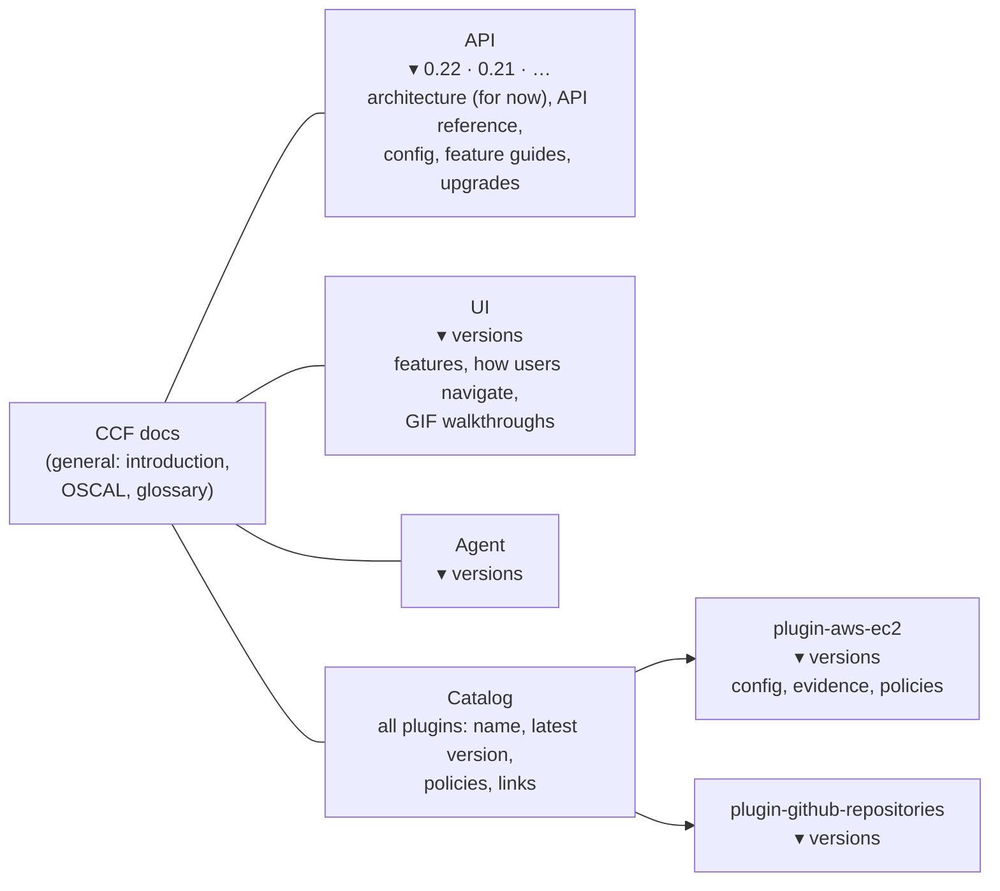
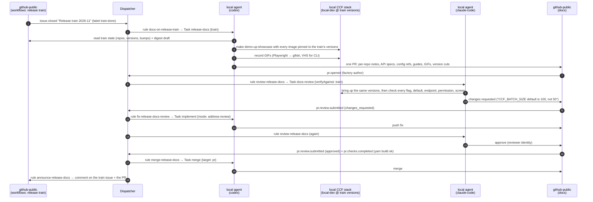
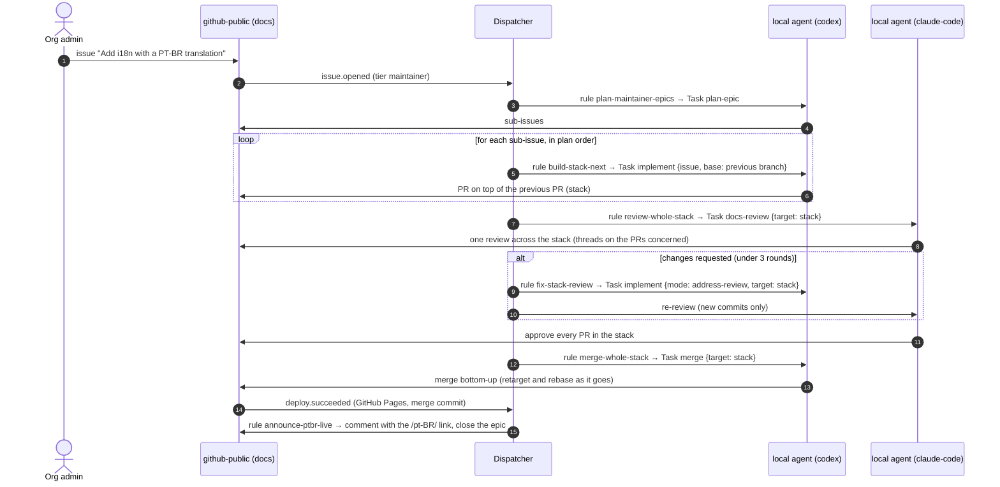
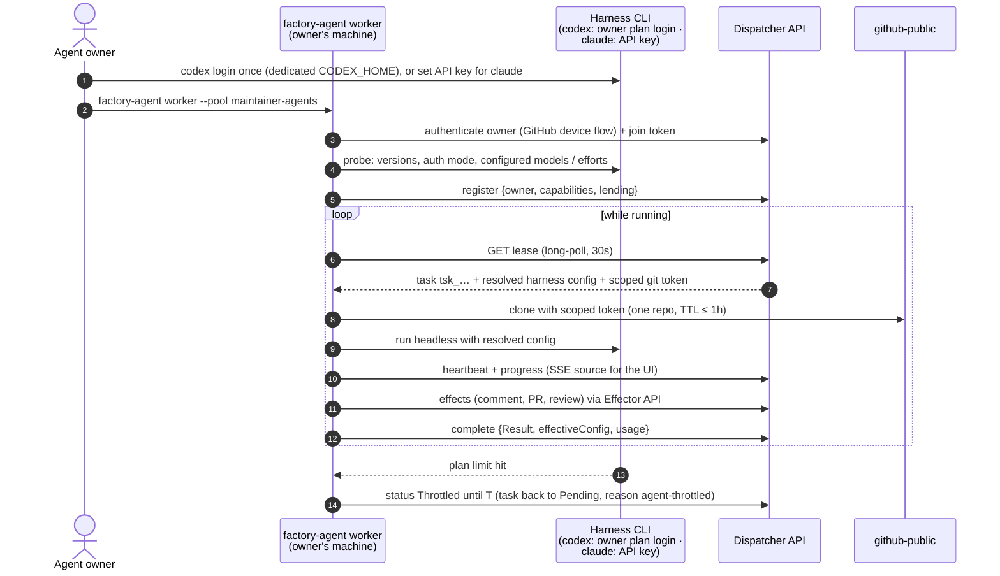

# 10 — Proof of concept

> Status: **draft for discussion** · Last updated: 2026-10-15

## PoC scope

The PoC demonstrates **two use cases**, end to end and fully automatic, on **one provider (`github-public`)**, with **registered local agents only**. It also reviews every human PR on `docs`.

| In | Out (future work) |
|---|---|
| **Use case 1, release train → versioned docs** (the main one): when a release train finishes, one docs PR documents every release in it, in **per-repository versioned docs**. It's then reviewed against those versions, approved and merged automatically. | Slack (Q1), GHE, GitLab, Jira |
| **Use case 2, a docs epic**: an i18n + PT-BR issue becomes sub-issues, then a PR **stack**, then one stack review, then a stack merge, then PT-BR live | Ephemeral pools, API-key pools, Cloud Run hosting |
| **Human PRs on `docs`**: every one gets a factory review (Q9). No pushes to them, no merges. | Approvals (Q18), shadow mode (Q10) |
| Provider `github-public` only. Notifications are GitHub comments. | — |
| **Registered pool `local`**: **Gustavo's machine (no limits)** plus **one more maintainer** (Q16), running **Codex and Claude Code on their owners' subscriptions**. Each owner decides how much capacity to lend. | Org API keys for Claude (beyond the PoC) |
| Dispatcher: one Go binary, in-memory store with **90-day retention** for runs and transcripts (Q13), GitHub App webhook through a tunnel, minimal UI (board, run view, decisions) | Postgres, HA |
| Licence: **AGPL-3.0** (Q14). Catalog and prompts are public; secrets are referenced only. | — |

> **Harness auth in the PoC (confirmed).** All steps run on local harnesses using subscriptions. The PoC is the factory's developers running and validating their own system on their own machines. Beyond the PoC, Claude moves to org API keys ([Registered agents](#registered-agents-codex-on-subscriptions-claude-on-api-keys)).

**Success criteria**

1. **Release train closes → merged docs PR with no human action.** The train must include at least one patch release (notes only) and one minor release (full docs: release notes, API reference bound to the version, config reference, user guide with at least one GIF recorded from the stack, an upgrade note if needed, and a version cut for that repo).
2. The review step **fails a deliberately wrong claim**, such as a renamed `CCF_*` flag or a wrong default, by checking it against the running versions, and the factory fixes it before merging.
3. **i18n epic → sub-issues → PR stack → stack review → stack merge → PT-BR live on GitHub Pages**, with no human action after opening the issue.
4. **A human PR on `docs` gets a factory review** within minutes, and nothing else happens to it.
5. Author and reviewer run on **different harnesses** (Codex writes, Claude Code reviews), resolved from [patterns](03-domain-model.md#patterns-in-harness-config), and each Result reports the exact effective config.
6. Restarting the dispatcher mid-cascade loses nothing rules need. The state is rebuilt from projections.
7. **No provider credential or LLM credential is ever stored by the dispatcher or sent across it**, apart from per-task, scoped git tokens.

## Versioned docs per repository

Each CCF repo has its own release cycle, so each one gets its **own independently versioned docs instance**. Docusaurus supports this directly:

- **One docs plugin instance per repo.** Each is an `@docusaurus/plugin-content-docs` instance with its own `id`, `path`, `routeBasePath` and sidebar.
- **Its own versions.** Each instance keeps its own `<id>_versions.json`, `<id>_versioned_docs/` and `<id>_versioned_sidebars/`, and gets cut with `docusaurus docs:version:<id> <version>`.
- **Its own version dropdown** in the navbar (`docsVersionDropdown` with `docsPluginId`).

### How readers navigate



- **Navbar:** CCF (general) · API · UI · Agent · Catalog. Each product item has its own version dropdown.
- **API** also hosts the **architecture docs for now**, since there's no architecture repo. They move from today's general section into the `api` instance.
- **UI** is where features are described and shown, including how users navigate, with GIF walkthroughs.
- **Catalog** is a landing page listing every plugin with its latest version. Clicking a plugin opens **that plugin's own versioned instance**: pick a version and see everything about it (configuration, evidence collected, its policies). So "a catalog" here means a **catalog page in front of per-plugin versioned instances**, which gives the per-version, per-plugin browsing you described.
- **Policies** have **a policies catalog on each plugin's page** (Q22). There are more policy repos than plugins (for example `plugin-aws-ecr` has image, registry and repository policy bundles; `plugin-aws-elb` has four), and each is released independently. So each plugin page lists **all its policy bundles**, with each bundle's latest version, the controls it covers, and which plugin version lines it's compatible with. Bundles aren't versioned instances of their own.
  - The plugin ↔ policy-bundle mapping is **explicit in the manifest**, because repo names don't always line up (e.g. `plugin-aws-acm` ↔ `plugin-aws-acm-certificate-policies`; `plugin-file-*` bundles).
  - A policy-bundle release updates its row in the plugin's policies catalog, in every minor line it's compatible with. It never cuts a plugin version.

### Keeping ~60 instances manageable

- **Generated, not hand-written.** Instances are declared in a manifest in `docs`, e.g. `instances.yaml` seeded from `workflows/repos.yaml`. `docusaurus.config.js` builds the plugin list, navbar and catalog page from it. The first release of a new plugin adds its manifest entry, so the factory onboards new plugins by itself.
- **One version per minor line** (Q21, decided), e.g. `api` `0.22`, not `0.22.0`/`0.22.1`/…. Patch releases update their minor line's pages and add to its release notes. That keeps version counts and build times sane.
- **Build time** grows with instances × versions, so measure it in the restructure PR. If needed, build only the newest N versions per instance (`onlyIncludeVersions`) and keep older ones as archived static snapshots.

```text
docs/                          # general (CCF), unversioned
api/  api_versioned_docs/version-0.22/  api_versions.json   # incl. architecture (for now)
ui/   ui_versioned_docs/…      ui_versions.json
agent/ …
plugins/aws-ec2/  plugin-aws-ec2_versioned_docs/version-1.4/  plugin-aws-ec2_versions.json
openapi/api/0.22.yaml          # API spec bound to each api version line
src/pages/catalog.tsx          # generated catalog landing page
instances.yaml                 # repo → instance manifest, incl. plugin → policy-bundle mapping (drives config, navbar, catalog)
```

### What every release gets

This is the `docs-release` skill's checklist:

| Section | Content | Source |
|---|---|---|
| **Release notes** | What changed, highlights first (e.g. performance gains), linked PRs | Release notes plus the train's digest draft |
| **API reference** | The **full spec bound to that release**, rendered per version (e.g. `docusaurus-plugin-openapi-docs`) | `api/docs/swagger.yaml` at the tag |
| **Configuration reference** | Every new or changed `CCF_*` setting: purpose, type, **default**, examples | Diff of config code and defaults between `previousTag..tag` |
| **Feature description and user guide** | What the feature is for, how it works, how to enable it, **permissions needed**, walkthroughs. **Prefer GIFs from the running system over words.** | Code diff, `authz-roles.yaml` diff, the running stack |
| **Upgrade guide** | Breaking changes, renamed flags, migrations (minor and major releases) | Diff, release notes, `release:major-approved` signals |
| **Catalog** | Plugin pages: configuration and evidence (plugin releases); the plugin's **policies catalog** rows: bundle version, controls covered, compatible plugin lines (policy releases) | Plugin and policy repos at the tag, plus the manifest mapping |
| **Version cut** | `docusaurus docs:version:<id> <minor line>` for a new minor or major release; patches update their line | — |

**Example, `api` v0.22.0.** The PR adds:

- the new **batch endpoint**: what it does, how to call it, the permissions it needs;
- the new `CCF_*` parameters and their defaults;
- the performance gains in the release notes;
- the full v0.22.0 API spec, rendered under the `api` `0.22` version.

Patch releases get release notes, an API spec refresh if it changed, and in-place fixes to their minor line. Minor and major releases get everything plus a new version cut.

## Use case 1: release train → versioned docs → review → merge



What makes this work:

- **The train's own end signal.** `workflows`' release train closes its tracking issue (`Release train YYYY-MM`) with the label `train:done` once every repo is released. The issue body carries the train's state as JSON (repos, versions), and the closing comments carry the **digest draft** (release notes grouped across repos). The rule triggers on that `issue.closed`; the `docs-release` skill reads the state. Switching to one PR per release is one rule swap ([below](#rules-use-case-1-pack-release-docs)).
- **The real system.** `local-dev`'s compose stack takes image versions from the environment (`CCF_API_IMAGE`, `CCF_AGENT_VERSION`, …), and `make demo-up-showcase` seeds realistic data. The `docs-gif` skill (new) drives the UI with Playwright and records to GIF (gifski), and uses VHS for CLI flows. The existing `sidebyside` and `ccf-test` skills cover screenshots and API probes.
- **Consistency.** A `STYLE.md` in `docs` covers voice, structure, "prefer a GIF over a paragraph", and GIF size and length limits. A `docs-map.yaml` says which pages and instances cover which repo. The `docs-style` skill applies both, and the reviewer checks against them.
- **Review against the versions.** `docs-review` with `verifyAgainst: train` brings up **the same** versions and checks every flag, default, endpoint, permission and screenshot claim. Using a different harness from the author's reduces shared blind spots.
- **Reads need no token.** CCF repos are public, so the agent clones source repos at their tags anonymously. Only `docs` gets a write token.

## Use case 2: the i18n + PT-BR epic



A plausible plan for the issue (the agent decides; this is just to make the shape concrete):

1. Enable Docusaurus i18n (`locales: ['en', 'pt-BR']`, locale dropdown, CI builds every locale). Today `docusaurus.config.js` has `locales: ['en']`. It must work with the per-repo versioned instances.
2. Add a PT-BR glossary for CCF and OSCAL terms (evidence, control, assessment plan…) and a translation contributor guide.
3. Translate the general section (`introduction/`, `architecture/`).
4. Translate `oscal/`, `glossary` and `index`.
5. Translate the theme and navbar strings (`docusaurus write-translations`).

## PoC catalog

```text
catalog/
├── providers/github-public.yaml
├── groups/maintainers.yaml
├── pools/local.yaml
├── queues/poc.yaml
├── taskspecs/
│   ├── release-docs.yaml      # UC1 author
│   ├── plan-epic.yaml         # UC2 decompose
│   ├── implement.yaml         # UC1 review fixes · UC2 stack PRs and fixes
│   ├── docs-review.yaml       # UC1 + UC2 + human PRs (pr | stack)
│   └── merge.yaml             # UC1 + UC2 (pr | stack)
├── templates/                 # github bodies only
│   ├── release-docs-published.yaml
│   ├── epic-plan.yaml
│   ├── ptbr-live.yaml
│   └── needs-human.yaml
├── rules/
│   ├── release-docs/          # pack: release-docs (UC1)
│   ├── docs-epic/             # pack: docs-epic    (UC2)
│   └── review-human/          # pack: review-human (Q9)
├── rulesets/
│   ├── poc-release-docs.yaml
│   ├── poc-docs-epic.yaml
│   └── poc-docs-human-review.yaml
└── testdata/                  # recorded and fake webhooks: fake trains, fake versions, human PRs
```

### Provider, Group, Pool, Queue

```yaml
kind: Provider
metadata: { name: github-public, labels: { family: github, network: public } }
spec:
  type: github
  github:
    apiURL: https://api.github.com
    webhook: { path: /hooks/github-public, secretRef: { name: github-public-webhook, key: secret } }
    identities:                                     # new Apps, created and provided for the PoC (Q4)
      author:   { appID: <ccf-factory>,          privateKeyRef: { name: ccf-factory-app, key: private-key } }
      reviewer: { appID: <ccf-factory-reviewer>, privateKeyRef: { name: ccf-factory-reviewer-app, key: private-key } }
  scope: { orgs: [compliance-framework] }
  trust:
    - { tier: maintainer, group: maintainers }
    - { tier: anyone }
---
kind: Group
metadata: { name: maintainers }
spec:
  members:
    - { provider: github-public, orgRole: { org: compliance-framework, role: admin } }   # the CCF org admins (Q17)
---
kind: Pool
metadata: { name: local }
spec:
  mode: registered
  admission: { tokenRef: { name: local-pool, key: join-token }, owners: maintainers }
  lease: { ttl: 2m, heartbeat: 30s, maxTasksPerAgent: 1 }
---
kind: Queue
metadata: { name: poc }
spec:
  pool: local
  concurrency: 2
  budget: { daily: { runs: 40 } }
  retry: { max: 1, on: [agent-lost, infra-failure] }   # throttling never consumes an attempt
```

PoC agents register like this. They live in the DB, not the catalog: **each owner sets how much they lend** in their worker's local config, with no catalog PR needed.

```yaml
kind: Agent
metadata: { name: agt_gus-mbp }
spec:
  pool: local
  owner: "github-public:gusfcarvalho"
  capabilities:
    harnesses:
      - { name: codex, auth: subscription, models: [gpt-5-codex], reasoningEffort: [low, medium, high] }
      - { name: claude-code, auth: subscription, models: [claude-sonnet-5-5, claude-opus-5-5], reasoningEffort: [low, medium, high, max] }
    labels: [has-local-stack, gif-tooling]       # docker + local-dev checkout; playwright, gifski, vhs
  lending:                                       # the owner's consent, set locally
    unlimited: true                              # full throttle: any queue, any hour, no daily cap
    maxConcurrent: 2
---
kind: Agent
metadata: { name: agt_maintainer-2 }
spec:
  pool: local
  owner: "github-public:<maintainer>"
  capabilities:
    harnesses: [{ name: codex, auth: subscription, models: [gpt-5-codex], reasoningEffort: [low, medium, high] }]
    labels: []
  lending:
    queues: [poc]
    harnesses: [codex]                           # lend Codex only
    maxConcurrent: 1
    maxRunsPerDay: 10
    maxTokensPerDay: 2000000
    hours: "Mon-Fri 09:00-18:00 Europe/London"
```

The scheduler respects `lending` exactly as the owner set it. Changing it is a local config edit plus a worker reload, and the UI shows each agent's current lending.

### TaskSpecs

```yaml
kind: TaskSpec
metadata: { name: release-docs }
spec:
  description: Document every release in a finished release train, in per-repository versioned docs.
  inputs:                                   # declared inputs; rules pass values via dispatch.inputs
    train:       { type: string, required: true }        # e.g. compliance-framework/workflows#123
    depthPolicy: { type: object, default: { patch: notes, minor: full, major: full } }
  instructions: { template: prompts/release-docs.md.tmpl, headless: true }
  skills:
    - { source: ccf-skills, ref: v0.8.0, use: [docs-release, docs-style, docs-gif, ccf-test, sidebyside] }
  requires: { labels: [has-local-stack, gif-tooling] }      # matched against agent labels
  harness:
    allowed: [{ name: codex, models: ["gpt-5*"], reasoningEffort: "*" }, { name: claude-code, models: ["claude-*-5-*"], reasoningEffort: "*" }]
    default: { name: codex, config: { model: "gpt-5*", reasoningEffort: high } }
  workspace:
    repos:
      - { ref: compliance-framework/docs@main, mode: rw }       # the only writable repo
      - { ref: compliance-framework/local-dev@main, mode: ro }  # stack bootstrap
    publicReads: true                                           # released repos are cloned anonymously at their tags
  identity: author
  permissions: { contents: write, pull_requests: write, issues: read }
  effects: { allow: [push-branch, pr.open, pr.comment, label.add] }
  limits: { maxWallClock: 90m, maxTurns: 200 }
  output:
    schema: schemas/results/release-docs.json   # per repo: version, depth, sections written, gifs
    outcomes: [pr-opened, no-docs-change, blocked]
---
kind: TaskSpec
metadata: { name: plan-epic }
spec:
  description: Decompose a large docs request into ordered, independently reviewable sub-issues.
  instructions: { template: prompts/plan-epic.md.tmpl, headless: true }
  skills: [{ source: ccf-skills, ref: v0.8.0, use: [plan-epic, docs-style] }]
  harness: { default: { name: codex, config: { model: "gpt-5*", reasoningEffort: high } } }
  workspace: { repos: [{ ref: compliance-framework/docs@main, mode: ro }] }
  identity: author
  permissions: { issues: write, contents: read }
  effects: { allow: [create-issue, sub-issue.add, comment, label.add] }
  limits: { maxWallClock: 20m }
  output:
    schema: schemas/results/plan-epic.json        # { plan: [{ issue, title, dependsOn }] }
    outcomes: [decomposed, single, needs-info]
---
kind: TaskSpec
metadata: { name: implement }
spec:
  description: Implement one issue as a PR (optionally stacked), or address review feedback on a PR or stack.
  inputs:
    mode:   { type: string, enum: [new, address-review], default: new }
    target: { type: string, enum: [pr, stack], default: pr }
    issue:  { type: string }                      # for mode new
    base:   { type: string, default: main }       # branch to stack on
  instructions: { template: prompts/implement.md.tmpl, headless: true }
  skills: [{ source: ccf-skills, ref: v0.8.0, use: [lisa, resolve, docs-style] }]   # lisa one-shot; stack ops via the Effector
  harness: { default: { name: codex, config: { model: "gpt-5*", reasoningEffort: medium } } }
  workspace: { repos: [{ ref: "=task.target.repo + '@' + inputs.base", mode: rw }] }
  identity: author
  permissions: { contents: write, pull_requests: write, issues: read }
  effects: { allow: [push-branch, pr.open, pr.update, pr.comment, thread.reply, thread.resolve, stack.push] }
  limits: { maxWallClock: 45m }
  output: { schema: schemas/results/implement.json, outcomes: [pr-opened, pr-updated, blocked, needs-info] }
---
kind: TaskSpec
metadata: { name: docs-review }
spec:
  description: Review a docs PR or stack for accuracy (against running CCF versions when given), style, versioning and i18n.
  inputs:
    target:        { type: string, enum: [pr, stack], default: pr }
    verifyAgainst: { type: object }               # { train } or { repo, tag } → bring up those versions and check claims
    checks:        { type: array, default: [style, build] }   # + version-accuracy, versioning, i18n
  instructions: { template: prompts/docs-review.md.tmpl, headless: true }
  skills: [{ source: ccf-skills, ref: v0.8.0, use: ["ccf-review:review", docs-style, docs-verify, ccf-test] }]
  requires: { labels: [] }                        # has-local-stack added at dispatch when verifyAgainst is set
  harness: { default: { name: claude-code, config: { model: "claude-{sonnet,opus}-5-*", reasoningEffort: high } } }
  workspace: { checkout: read-only }
  identity: reviewer
  permissions: { pull_requests: write, contents: read }
  effects: { allow: [review.comment, review.request-changes, review.approve, thread.reply] }
  limits: { maxWallClock: 60m }
  output: { schema: schemas/results/review.json, outcomes: [approved, changes-requested, commented, needs-human] }
---
kind: TaskSpec
metadata: { name: merge }
spec:
  description: Re-verify gates and merge a PR, or a whole stack bottom-up. If the reviewer App's approval doesn't count toward required reviews, add the merge label instead (Q5).
  inputs:
    target:        { type: string, enum: [pr, stack], default: pr }
    requiredCheck: { type: string, default: "ci / required" }   # "test-build" until docs is on the shared workflows (DWF)
  instructions: { template: prompts/merge.md.tmpl, headless: true }
  skills: [{ source: ccf-skills, ref: v0.8.0, use: [merge] }]
  harness: { default: { name: codex, config: { model: "gpt-5*", reasoningEffort: low } } }
  workspace: { checkout: rebase-only }
  identity: reviewer
  permissions: { contents: write, pull_requests: write }
  effects: { allow: [pr.merge, pr.retarget, stack.rebase, stack.push, pr.comment, label.add] }
  limits: { maxWallClock: 20m }
  output: { schema: schemas/results/merge.json, outcomes: [merged, labelled-for-merge, rebased-with-conflicts, blocked, needs-human] }
```

### Rules, use case 1 (`pack: release-docs`)

String values starting with `=` are **CEL, evaluated at runtime** (`"=event.object.ref"`), in rules and in TaskSpec fields that depend on inputs. `{{ params.x }}` is **substituted at catalog load**. Actions see state written by earlier actions in the same rule, and rules see state written by higher-priority rules for the same event.

```yaml
- name: docs-on-release-train
  providerSelector: { matchLabels: { family: github } }
  on: [issue.closed]
  params: { trainManifest: repos.yaml, allowDryRun: false, docsRepo: compliance-framework/docs }   # dev RuleSet overrides these
  where: >
    event.repo == 'compliance-framework/workflows' && has(event.train) &&
    event.train.manifest == params.trainManifest &&
    (('train:done' in event.issue.labels && !event.train.dryRun) ||
     (params.allowDryRun && 'train:dry-run' in event.issue.labels))
  actions:
    - dispatch:
        taskSpec: release-docs
        queue: poc
        target: { repo: "{{ params.docsRepo }}" }
        inputs: { train: "=event.object.ref" }
    - set: { release: drafting, train: "=event.object.ref" }

# Alternative, one PR per release: swap the rule above for this one in the RuleSet.
# - name: docs-on-release
#   on: [release.published]
#   where: "!event.release.semver.prerelease"
#   actions: [{ dispatch: { taskSpec: release-docs, queue: poc, target: { repo: compliance-framework/docs },
#               inputs: { train: "=event.repo + '@' + event.release.tag" } } }]

- name: review-release-docs
  providerSelector: { matchLabels: { family: github } }
  on: [pr.opened, pr.updated]
  where: "actor.isFactory && has(item.state.release)"
  actions:
    - cancel: { taskSpec: docs-review }
    - dispatch:
        taskSpec: docs-review
        queue: poc
        requires: { labels: [has-local-stack] }
        inputs:
          target: pr
          verifyAgainst: "={'train': item.state.train}"
          checks: [version-accuracy, versioning, style, build]
    - set: { review: running }

- name: fix-release-docs-review
  providerSelector: { matchLabels: { family: github } }
  on: [pr.review.submitted]
  where: "has(item.state.release) && event.review.state == 'changes_requested' && item.count('implement') < 3"
  actions: [{ dispatch: { taskSpec: implement, queue: poc, inputs: { mode: address-review, target: pr } } }]

- name: merge-release-docs                 # excluded from the RuleSet until everything else is trusted (Q10)
  providerSelector: { matchLabels: { family: github } }
  on: [pr.review.submitted, pr.checks.completed]
  where: >
    has(item.state.release) &&
    item.pr.approvedBy.exists(a, a.identity == 'reviewer' && a.commit == item.pr.head) &&
    item.pr.checks.state == 'success' &&
    !item.pr.labels.exists(l, l in ['do-not-merge', 'factory:hold', 'factory:stop'])
  params: { requiredCheck: "ci / required" }
  actions: [{ dispatch: { taskSpec: merge, queue: poc, inputs: { target: pr, requiredCheck: "{{ params.requiredCheck }}" } } }]

- name: announce-release-docs
  on: [factory.run.completed]
  where: "run.spec == 'merge' && run.outcome == 'merged' && has(item.state.release)"
  actions:
    - notify: { template: release-docs-published, to: [{ item: all }] }   # the docs PR and the (closed) train issue
    - set: { release: published }
```

### Rules, use case 2 (`pack: docs-epic`)

```yaml
- name: plan-maintainer-epics
  providerSelector: { matchLabels: { family: github } }
  on: [issue.opened]
  where: "actor.tier == 'maintainer'"
  actions: [{ dispatch: { taskSpec: plan-epic, queue: poc } }, { set: { plan: planning } }]

- name: build-stack-start
  on: [factory.run.completed]
  where: "run.spec == 'plan-epic' && run.outcome == 'decomposed'"
  actions:
    - set: { plan: "=run.result.plan", stackNext: 0, stackTotal: "=size(run.result.plan)" }
    - notify: { template: epic-plan, to: [{ item: primary }] }
    - dispatch: { taskSpec: implement, queue: poc, inputs: { mode: new, target: pr, issue: "=item.state.plan[0].issue", base: main } }

- name: build-stack-next
  on: [factory.run.completed]
  where: "run.spec == 'implement' && run.inputs.mode == 'new' && run.outcome == 'pr-opened' && item.state.stackNext + 1 < item.state.stackTotal"
  actions:
    - set: { stackNext: "=item.state.stackNext + 1" }      # later actions see the updated state
    - dispatch:
        taskSpec: implement
        queue: poc
        inputs: { mode: new, target: pr, issue: "=item.state.plan[item.state.stackNext].issue", base: "=run.result.branch" }

- name: review-whole-stack
  on: [factory.run.completed]
  where: >
    (run.spec == 'implement' && run.inputs.mode == 'new' && run.outcome == 'pr-opened' && item.state.stackNext + 1 == item.state.stackTotal) ||
    (run.spec == 'implement' && run.inputs.target == 'stack' && run.outcome == 'pr-updated')
  actions:
    - dispatch: { taskSpec: docs-review, queue: poc, inputs: { target: stack, checks: [i18n, versioning, style, build] } }
    - set: { review: running }

- name: fix-stack-review
  on: [factory.run.completed]
  where: "run.spec == 'docs-review' && run.inputs.target == 'stack' && run.outcome == 'changes-requested' && item.count('docs-review') < 3"
  actions: [{ dispatch: { taskSpec: implement, queue: poc, inputs: { mode: address-review, target: stack } } }]

- name: record-review-outcome
  on: [factory.run.completed]
  priority: 100                                            # runs first, so later rules see the new state
  where: "run.spec == 'docs-review'"
  actions: [{ set: { review: "=run.outcome" } }]

- name: merge-whole-stack                  # excluded from the RuleSet until everything else is trusted (Q10)
  providerSelector: { matchLabels: { family: github } }
  on: [factory.run.completed, pr.checks.completed]
  where: >
    has(item.state.plan) && item.state.review == 'approved' &&
    item.prs.all(p, p.checks.state == 'success')
  params: { requiredCheck: "ci / required" }
  actions: [{ dispatch: { taskSpec: merge, queue: poc, inputs: { target: stack, requiredCheck: "{{ params.requiredCheck }}" } } }]

- name: record-merge-outcome
  on: [factory.run.completed]
  priority: 100
  where: "run.spec == 'merge'"
  actions: [{ set: { merge: "=run.outcome" } }]

- name: announce-ptbr-live
  providerSelector: { matchLabels: { family: github } }
  on: [deploy.succeeded]
  where: "has(item.state.plan) && item.state.merge == 'merged'"
  actions:
    - notify: { template: ptbr-live, to: [{ item: primary }] }   # "PT-BR is live: https://compliance-framework.github.io/docs/pt-BR/"
    - effect: { op: close, target: primary }
```

### Rules, human PRs (`pack: review-human`)

```yaml
- name: review-human-prs
  providerSelector: { matchLabels: { family: github } }
  on: [pr.opened, pr.updated, pr.ready_for_review]
  where: "!actor.isFactory && !actor.isBot && !item.pr.draft"
  actions:
    - cancel: { taskSpec: docs-review }          # a newer commit supersedes an in-flight review
    - dispatch: { taskSpec: docs-review, queue: poc, inputs: { target: pr, checks: [style, versioning, build] } }
```

The human-PR rules **never** dispatch `implement` or `merge`. Authors address the review themselves, and each new commit triggers a re-review.

Shared safety nets live in each pack: an `escalate-needs-human` rule (any `needs-human` or `blocked` outcome, or 3 review rounds → `needs-human` label plus the `needs-human` comment template).

### RuleSets

```yaml
kind: RuleSet
metadata: { name: poc-release-docs }
spec:
  providerSelector: { matchLabels: { family: github, network: public } }
  scope: { repos: ["compliance-framework/workflows", "compliance-framework/docs"] }   # the train issue + the docs PR it produces
  rules:
    selector: { matchExpressions: [{ key: pack, operator: In, values: [release-docs, shared] }] }
    exclude: [merge-release-docs]          # remove this line once everything else is trusted (Q10)
  stateKeys: [release, train, review, merge]
---
kind: RuleSet
metadata: { name: poc-docs-epic }
spec:
  providerSelector: { matchLabels: { family: github, network: public } }
  scope: { repos: ["compliance-framework/docs"] }
  rules:
    selector: { matchExpressions: [{ key: pack, operator: In, values: [docs-epic, shared] }] }
    exclude: [merge-whole-stack]           # same
  stateKeys: [plan, stackNext, stackTotal, review, merge]
---
kind: RuleSet
metadata: { name: poc-docs-human-review }
spec:
  providerSelector: { matchLabels: { family: github, network: public } }
  scope: { repos: ["compliance-framework/docs"] }
  rules: { selector: { matchExpressions: [{ key: pack, operator: In, values: [review-human, shared] }] } }
```

**Dev RuleSets** (`dev-release-docs`, `dev-docs-epic`) select the same packs but target **`mock-docs`** and mock trains: they override `trainManifest: repos.mock.yaml`, `allowDryRun: true` and `docsRepo: compliance-framework/mock-docs`. Full table: [catalog-poc.md §Dev and prod RuleSets](workstreams/catalog-poc/LLD/catalog-poc.md#dev-and-prod-rulesets).

The packs coexist on `docs` PRs:

- `release-docs` and `docs-epic` rules are guarded by their own state keys (`has(item.state.release)` or `has(item.state.plan)`) and only act on factory-authored work.
- `review-human` only acts on PRs that are neither factory- nor bot-authored.

### What the PoC adds to the model

These are the PoC's deltas to [03](03-domain-model.md). They've been folded back into 03, where marked.

| Addition | Why | In 03 |
|---|---|---|
| `TaskSpec.inputs` (declared, typed) and `dispatch.inputs` | One task spec, several modes: `target: pr \| stack`, `mode: address-review`, `depthPolicy` | ✅ |
| `TaskSpec.requires.labels` (extendable at dispatch) matched against agent labels | GIF recording and version checks need a machine with the local stack | ✅ |
| `workspace.repos` (several repos, **one** writable) and `publicReads` | Release docs read many public repos at their tags and write only to `docs` | ✅ |
| `=` prefix for runtime CEL values (replaces `setExpr`); actions see state updated by earlier actions in the same rule | Computing inputs (`base`, `train`) and stack counters | ✅ |
| `event.release.semver` + `previousTag` facts | The per-release alternative rule, and depth decisions | ✅ |
| `deploy.succeeded` event (GitHub `deployment_status`), linked to work items by merge commit | "Me seeing PT-BR docs": announce when it's actually live | ✅ |
| Effects `sub-issue.add`, `stack.push`, `stack.rebase`, `pr.retarget` | Epic decomposition and PR stacks (`lisa`'s `gh-stack` support) | ✅ |
| `RuleSet.scope.exclude` and `rules.exclude` | Scoping, and keeping `merge` rules out until trusted | ✅ |
| Group member source `orgRole` | `maintainers` = CCF org admins | ✅ |
| New skills in `ccf-skills`: `docs-release`, `docs-style`, `docs-gif`, `docs-verify`, `plan-epic`, `merge` | Use-case logic stays in skills, not in the factory | (skills repo) |

### Prerequisites outside the factory

- **`docs` restructure** (one-off PR):
  - generated multi-instance versioned docs from an `instances.yaml` manifest, **`api` first** (Q20, with the architecture docs moved in), then `ui`, `agent` and the plugins;
  - the catalog landing page (Q19);
  - the OpenAPI rendering plugin;
  - `STYLE.md` and `docs-map.yaml`;
  - a few **fake versions** to exercise version cutting during development (Q10).
- **GitHub Apps** `ccf-factory` and `ccf-factory-reviewer`, created and installed by Gustavo (Q4).
- **Branch protection** on `docs` `main` requiring the CI check (`test-build` today, `ci / required` once docs moves onto the shared workflows, [DWF](workstreams/definitions.md#dwf-docs-onto-shared-workflows)) (and an approval, which `ccf-factory-reviewer` provides if allowed; see Q5).
- **Agents** with Docker, a `local-dev` checkout, `gh-stack`, Playwright, `gifski` and `vhs`.

## Is there tooling that already matches?

No single tool matches the model. Here's how each candidate maps onto its parts (✅ yes · ◐ partly · ❌ no):

| Tool | Providers / ingress | Rules + RuleSets | TaskSpecs | Queue → Pool | Registered (pull) agents | Claude Code **and** Codex | Work-item state, approvals | UI |
|---|---|---|---|---|---|---|---|---|
| **Argo Events (+ Workflows)** | ✅ GitHub, Slack EventSources | ◐ Sensor filters; no state, no rule reuse | ❌ (trigger templates) | ❌ | ❌ | n/a | ❌ | ◐ |
| **kagent** | ❌ | ❌ | ✅ `Agent` CRD with git-pinned plugins, Claude harness | ❌ | ❌ (in-cluster agents) | ◐ Claude yes; Codex unverified | ❌ | ✅ |
| **agent-orca** | ◐ queue/chat input sources | ❌ static DAG | ◐ | ◐ warm pools | ❌ | ❌ (OpenAI-chat contract) | ◐ checkpoints | ✅ |
| **Claude Managed Agents** | ❌ | ❌ | ✅ `ant apply` agent manifests | ◐ | ◐ self-hosted **workers poll** for work | ❌ Claude only, API key | ◐ sessions | ◐ |
| **GitHub Actions + self-hosted runners** | ✅ GitHub only | ◐ `on:` + `if:`, but per-repo files (breaks P6) | ◐ reusable workflows | ◐ runner labels and groups | ✅ runners register and pull | ✅ | ❌ | ◐ |
| **Temporal / Hatchet** | ❌ | ❌ | ❌ | ✅ task queues | ✅ workers pull | n/a | ✅ durable | ✅ |
| **OpenHands** | ◐ (enterprise tier) | ❌ | ◐ | ❌ | ❌ | ✅ (via ACP) | ◐ | ✅ |
| **Open SWE** | ✅ GitHub, Slack, Linear | ❌ hard-coded | ◐ | ◐ sandboxes | ❌ | ❌ Deep Agents | ◐ | ✅ |

**Reading the table:**

- The **distinctive parts of our model are the rule layer** (reusable rules, mandatory RuleSets, factory events and approvals) and **capability-matched pools of harness agents** (pattern resolution, consent, plan throttling). Nobody has these.
- The **pull pattern itself is well-trodden**: GitHub self-hosted runners, Temporal/Hatchet workers, Managed Agents workers. Our lease protocol copies their shape: register, long-poll, heartbeat, complete.
- **One shortcut was considered and rejected for the PoC:** using GitHub self-hosted runners *as* the registered pool, with the dispatcher calling `workflow_dispatch` against `runs-on: [self-hosted, claude-code]`. It gives free registration and logs. But runner assignment can't do our capability and pattern matching, owner consent or plan throttling. It also runs workflow code on personal machines and ties the pools to GitHub. The lease API we'd build instead is small, and it's the core of the model.

**Verdict:** build it. Reuse libraries rather than platforms: CEL (`cel-go`), CloudEvents SDK, `go-github`, Slack `socketmode`, and a glob matcher with `{a,b}` support (`gobwas/glob`).

## Build on Kubernetes for the PoC?

**Recommendation: no.** Build the PoC as a **plain Go binary** that keeps the Kubernetes *shape* (resources, labels and selectors, controllers, a watchable `Store`), without depending on a cluster.

| Why not Kubernetes for the PoC | |
|---|---|
| Registered-only agents run **outside** any cluster | Kubernetes's main runtime value, scheduling pods, goes unused |
| We need **our own API** anyway | The lease protocol, Effector API, SSE progress and UI aren't things kube-apiserver can serve |
| Runtime kinds are **high-churn** | Events, runs and progress are a poor fit for etcd and CRDs, so we'd keep them outside even on Kubernetes |
| **Iteration speed** | `go run`, a tunnel and a laptop. No cluster, CRD generation, RBAC or webhook certificates. |

**What would flip it:**

- **ephemeral pod pools** (Agent Sandbox, gVisor) become a requirement (future work);
- you want **durable config without Postgres**, using etcd for the config kinds;
- ops wants **GitOps** (Flux / Argo CD) to apply the catalog instead of our catalog-sync.

The migration path then is: config kinds become CRDs (with `controller-runtime` for the config-facing controllers), runtime kinds move to Postgres, and the same reconcile logic stays. The resources are Kubernetes-shaped precisely so this stays a mechanical change.

## Registered agents: Codex on subscriptions, Claude on API keys

The PoC uses only registered agents. **In the PoC itself, both harnesses run on their owners' subscriptions** ([scope](#poc-scope)). Beyond the PoC, each harness authenticates differently:

| Harness | Auth | Used for | Billed to |
|---|---|---|---|
| **Codex** | The agent owner's **ChatGPT plan** (`codex login`, browser or `--device-auth`) | **Default factory traffic** | The owner's plan |
| **Claude Code** | An **Anthropic API key** (org-provisioned, configured on the agent machine) | Mostly **validation**: comparing or checking factory output | The org's API account (Console, or Bedrock/Vertex) |

### What the vendors' docs say, and what it means for the design

- **Anthropic** (Claude Code [Legal and compliance](https://code.claude.com/docs/en/legal-and-compliance), [Agent SDK overview](https://code.claude.com/docs/en/agent-sdk/overview)): API keys are the documented path for building products and services, and customers may provision their own keys for their own authorised users. **Using API keys for Claude settles the Claude side.**
- **OpenAI Codex** (checked for Q15; [Codex authentication docs](https://learn.chatgpt.com/docs/auth) and the [Terms of Use](https://openai.com/policies/terms-of-use/)):
  - **Sign in with ChatGPT** gives subscription access. **API keys are recommended for programmatic workflows such as CI/CD**, and remain "the recommended default for automation".
  - ChatGPT Enterprise offers admin-granted **access tokens** for trusted scripts, schedulers and private CI runners.
  - Headless machines should use device-code sign-in. Copying `~/.codex/auth.json` to another machine is documented only as a fallback, and the file must be treated like a password, never shared.
  - The Terms of Use forbid **sharing account credentials or letting others use your account**, and automated extraction of data or Output.
  - **No clause found that explicitly forbids** running the official CLI under your own login on your own machine.
  - **Reading for the PoC:** each owner runs the official `codex` CLI on their **own machine**, under their **own login** with device-code sign-in, on work they chose to lend. Credentials are never shared or copied, and the dispatcher never sees them. That's consistent with what's documented. But OpenAI's guidance leans towards API keys (or Enterprise access tokens) for automation, so **beyond the PoC, default traffic moves to API keys or access tokens**.

**Design consequences** (also [ADR-0008](adr/0008-llm-auth-stays-with-the-agent.md)):

1. The dispatcher **never sees, stores or forwards** LLM credentials of any kind. A Task says `llm: agent-local`. The Codex plan login and the Claude API key both live only on the agent machine.
2. Codex agents run the **unmodified** `codex` binary, signed in **by their owner through OpenAI's own flow**.
3. Claude agents get an **org-provisioned Anthropic API key**, one per agent (or per owner), so usage is attributable and keys can be revoked individually. Budgets for Claude are in USD, since `costUSD` is reported.
4. Agents are **owned by named people** (members of the pool's `owners` Group), who **consent**, through their agent's `lending` block, to what it takes (`lending`: queues, RuleSets, harnesses, concurrency, hours, runs and tokens per day, or unlimited).
5. **Routing by catalog, not by code:**
   - RuleSets default to `codex`.
   - Claude Code agents set `lending.queues: [validation]`.
   - A `validation` queue is fed by manual re-dispatch commands and sampling rules (e.g. `where: hash(item.id) % 10 == 0`, dispatching the same task spec to `claude-code` for comparison).
6. **Q15, checked:** fine for the PoC under the reading above. Beyond the PoC, Codex moves to API keys or Enterprise access tokens. Both are a drop-in (`auth: apiKey | accessToken`), with no design change.

### Agent lifecycle and lease protocol



| Endpoint | Purpose |
|---|---|
| `POST /api/v1/agents` | Register: owner identity, join token, capabilities, consent. Returns the agent id and a short-lived agent token. |
| `GET /api/v1/agents/{id}/lease?wait=30s` | Long-poll for a task. **Outbound only**, so it works behind NAT. The dispatcher's only public endpoints are this API and the GitHub webhook. |
| `POST /api/v1/leases/{id}/heartbeat` | Extend the lease (TTL 2m, heartbeat 30s) and stream progress |
| `POST /api/v1/leases/{id}/complete` / `abandon` | Finish with a Result, or hand the task back. `abandon` and expired leases put the task back to `Pending`. |
| `PATCH /api/v1/agents/{id}` | Status: `Ready`, `Throttled{until}`, `Draining`, `Offline` |

Delivery is **at-least-once**, so effects carry **idempotency keys** (task id plus an effect sequence number). A retried task never posts the same comment twice.

### Capabilities, matching and fairness

- **Probe at startup** for harness versions and auth mode. Plan-dependent **model and effort lists** come from the worker's local config (`~/.config/factory-agent/agent.yaml`), because harnesses don't reliably list what a plan allows. They're validated on first use: an unknown model failure marks that model unavailable for the agent.
- **Matching** (pool controller): the harness is allowed; [pattern resolution](03-domain-model.md#patterns-in-harness-config) succeeds; labels match; the owner's consent covers the queue and RuleSet; the agent is inside its hours and under `maxRunsPerDay`; it isn't throttled.
- **Lending:** each owner's `lending` block (queues, harnesses, concurrency, runs and tokens per day, hours, or `unlimited`) is set locally and enforced by the scheduler.
- **Fairness:** among agents that can take a task, least-recently-leased first. An `unlimited` agent is still preferred last when others have spare lending, so one owner's plan doesn't absorb everything by default (configurable per pool).

### Plan limits and backpressure

- Codex plans have rolling usage windows, and API keys have rate limits. When the harness reports a limit, the worker sets **`Throttled{until}`** (parsed reset time, or exponential backoff), and the task returns to `Pending` with the reason `agent-throttled`. That isn't a task failure, and it isn't a model failure.
- **Budgets:** Codex-on-plan runs count runs and tokens (`costUSD` is `null`). Claude-on-API-key runs also count USD.
- The UI shows each agent's state and throttle windows, so a starving queue is visible.

### Isolation on a personal machine

| Concern | Measure |
|---|---|
| Owner's personal setup leaking in | A **dedicated harness config dir** per worker (e.g. `CODEX_HOME`, `CLAUDE_CONFIG_DIR`; verify both). Codex is signed in once by the owner; Claude reads its API key from the worker's environment. No personal settings, plugins, MCP servers or memory. Skills are materialised per task. |
| Filesystem | A scratch workspace per task, deleted afterwards. Run the worker as a **dedicated OS user**, or in a container or devcontainer. |
| Network / commands | Wrap the harness in Anthropic `sandbox-runtime` (`srt`) or a container with an egress allow-list (GitHub, the LLM vendor, package registries) |
| GitHub access | **Never the owner's GitHub credentials.** Per-task App installation tokens, scoped to one repo and the task spec's permissions. Read-only task specs get read-only tokens. |
| Attribution | Effects go through the Effector API under the factory's App identities. PRs are authored by `ccf-factory[bot]`, not the owner. The Result records the agent, owner and auth mode for audit. |
| Untrusted input | Same fencing as everywhere ([07](07-security-and-governance.md)). A compromised run is bounded by the scoped token and the effects allow-list, not by the owner's machine permissions. |
| Owner control | `factory-agent pause`, consent lists, hours, and a local kill switch. Owners see what their agent ran in the UI. |

## Sources

- Claude Code, Legal and compliance (authentication and credential use): <https://code.claude.com/docs/en/legal-and-compliance>
- Claude Agent SDK overview (claude.ai login note): <https://code.claude.com/docs/en/agent-sdk/overview>
- Codex authentication (third-party summaries; verify against OpenAI docs): <https://www.mintlify.com/openai/codex/cli/login>, <https://claw.aguidetocloud.com/openai/codex-cli/auth/>
- Tool assessments: see [06](06-technology-options.md#sources)
