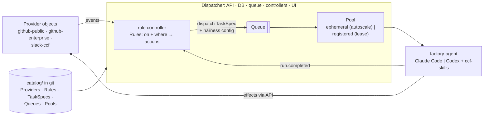

# CCF Factory: design

> Status: **draft v0.1 for discussion** · 2026-10-15
>
> The CCF Factory is an event-driven, LLM-powered software factory for the `compliance-framework` org, starting with `docs`. Providers (GitHub, Slack, release dispatches) raise events. A **central dispatch layer** of rules decides which **task spec** runs, when, with which harness, and on which pool. A **thin agent overlay** runs an LLM harness (Claude Code or Codex) loaded with `ccf-skills` to do the work: triage, release docs, fix, review and, optionally, merge.

## One-picture summary

## Reading order

| Doc | What's in it |
|---|---|
| [01 — Context and goals](01-context-and-goals.md) | Problem, goals, non-goals, principles, assets we already have, glossary |
| [02 — Architecture](02-architecture.md) | Layers, components, key sequences, deployment shapes |
| [03 — Domain model and catalog](03-domain-model.md) | Provider, Rule, RuleSet, TaskSpec, Queue, Pool, WorkItem, Task, Result, with example YAML |
| [04 — Rules in practice](04-flows.md) | **When each agent gets a task**: how rules cascade (triage → approve → implement → review), example rule packs, the `docs` RuleSets |
| [05 — Agent runtime](05-agent-runtime.md) | The thin overlay, harness adapters (Claude Code and Codex), skills portability, Effector, sandbox, evals |
| [06 — Technology options](06-technology-options.md) | agent-orca deep-dive, kagent, Agent Sandbox, Anthropic and OpenAI pieces, workflow engines, buy vs build |
| [07 — Security and governance](07-security-and-governance.md) | Trust boundaries, actor tiers, identities, tokens, kill switches, catalog governance |
| [08 — Roadmap](08-roadmap.md) | **PoC only**: foundations → use case 1 → human-PR review → use case 2 → enable merge; plus unplanned future work |
| [09 — Open questions and decisions](09-open-questions.md) | All decisions taken so far (Q1–Q22); nothing open right now |
| [10 — Proof of concept](10-poc.md) | PoC: **two use cases** (release → docs → review → merge; i18n epic → PR stack → PT-BR live), the **PoC catalog** for both, tooling fit, Kubernetes or not, registered agents |
| [adr/](adr/) | Proposed architecture decisions (0001–0008) |

## Headline proposals

1. **Mechanism in the engine, policy in the catalog.**
   - **Rules** are reusable and scope-less: `on` + `where` → actions.
   - **RuleSets** are mandatory: they bind provider instances and a scope, and select rules by ref or label.
   - Rules `dispatch` a **TaskSpec** into a **Queue**, which a **Pool** drains.

   ([03](03-domain-model.md), [ADR-0007](adr/0007-rules-and-controllers.md))
2. **Cascades are events.** `factory.run.completed`, `factory.approval.granted` (from Approvals answered in the UI, Slack or GitHub) and provider echoes such as `pr.opened` by the factory each trigger the next rule. `factory.*` events can only come from the built-in, reserved `factory` provider. ([04](04-flows.md#how-rules-cascade))
3. **Provider objects say how to connect** (public GitHub, GHE, a Slack workspace). **Groups** say who (maintainers, approvers), and **Templates** say what to send. ([03](03-domain-model.md#provider))
4. **Harness config accepts patterns** (`claude-{sonnet,haiku}-5-*`, `*`), resolved against what each agent offers, with the effective config reported back. ([03](03-domain-model.md#patterns-in-harness-config))
5. **The dispatcher is a small control plane:** API, watchable DB (in-memory first), queues, controllers and UI, in one binary. ([02](02-architecture.md#the-dispatcher-controllers-an-api-a-db-a-queue-and-a-ui))
6. **The factory owns its state**, rebuilt on startup from projections on providers. Config lives in git. ([ADR-0001](adr/0001-factory-owns-work-state.md), [ADR-0006](adr/0006-catalog-in-git.md))
7. **LLM auth stays with the agent.** The factory never handles LLM credentials, and git tokens are minted per task. ([ADR-0008](adr/0008-llm-auth-stays-with-the-agent.md), [ADR-0004](adr/0004-effector-and-per-role-identities.md))
8. **PoC: one plain Go binary (not Kubernetes) with registered agents only**, running Codex and Claude Code locally on their owners' subscriptions (Claude moves to org API keys beyond the PoC). It demonstrates two use cases: **release train → per-repository versioned docs → review → merge**, and **i18n epic → PR stack → PT-BR live**, plus a factory review of every human PR on `docs`. No existing tool covers the rule layer plus capability-matched agent pools. ([10](10-poc.md), [ADR-0005](adr/0005-poc-plain-go-binary-registered-agents.md))

> **Review progress:** 01 ✅ · 02–10 🔄 consistent with the current model (rules, PoC auth, registered agents), in review.

## Conventions for this folder

- Markdown plus Mermaid only (it renders on GitHub, and in VS Code or JetBrains with a Mermaid plugin).
- ADRs are numbered, never renumbered, and superseded rather than edited once accepted.
- The YAML in these docs is *illustrative*. The schemas in `catalog/schemas/` will be authoritative once they exist.
